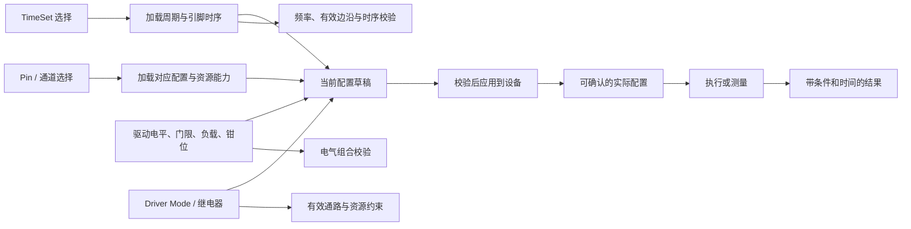

# ATE 引脚电子学：参数联动与数据刷新规则

日期：2026-11-23  
适用范围：保持现有 Pin Electronics 图及控件，确定功能开发所需的业务联动。  
依据：ATE 通用工作原理与本文末尾列出的厂商公开技术资料。**不采用现有代码或历史项目文档中的联动规则作为行业依据。**

## 1. 先回答“改了 A，要不要刷新 B、C”

**多数电压、电流、绝对时间都是独立设定值。修改其中一个，通常不应该自动改写其他设定值。** 需要变化的往往是校验结果、功能是否有效、配置状态，或者下一次实际测量的结果。

必须把“刷新”分成以下动作，否则容易实现成互相覆盖的输入框：

| 动作 | 含义 | 例子 |
| --- | --- | --- |
| 同步显示 | 同一个参数在两个位置展示，保持一致 | 顶部 Pin 和电路区 Pin Name |
| 重新计算 | B 是由 A 明确定义的派生量 | Period → Rate |
| 加载配置 | 对象或配置上下文变化，读取另一份设定 | 选择 Pin B → 显示 B 的配置 |
| 更新有效性 | 数值保留，改变该参数是否参与当前工作 | 比较关闭后，比较选通参数暂不参与执行 |
| 重新校验 | B 数值不变，但检查它与 A 的组合是否允许 | 周期缩短 → 检查采样时间是否越界 |
| 重新应用 / 回读 | 将配置交给设备，并更新可确认的实际配置状态 | 切换数字驱动与 PPMU |
| 重新测量 | 获取新条件下的真实结果，不能用猜测值代替 | 改负载电流后重新测量 DUT 输出电压 |
| 无动作 | 没有业务依赖，不更新该字段 | 改 Gate Time 不改 Vih |

**基本规则：自动改数值需要公式、显式引用或用户明确的批量操作；电气耦合本身不是自动改数值的依据。**

本文中“建议”表示适合本功能的产品规则，不冒充行业强制规范；“设备相关”表示必须由目标板卡和驱动接口确认。不同厂商没有统一的 UI 字段命名和刷新规范。

## 2. 图上的三类数据不能混用

### 2.1 设定值

Vih、Vil、Voh、Vol、Ioh、Iol、边沿时间、PPMU Force Value 等，表达“希望设备怎么工作”。它们通常由用户、配置文件或测试程序指定。

例如 Voh 是用来判断 DUT 输出高电平的门限，不是当前 DUT 实际输出电压。改了 Ioh，即使 DUT 输出电压因此下降，也不能把 Voh 输入框改成下降后的电压。[S1][S2]

### 2.2 派生值与有效状态

Rate、当前可用边沿、格式示意、通路是否参与工作、错误提示，来自设定值和设备能力，适合自动更新。

图上导线高亮最多表示某通路被配置或已确认启用，不能代表已经测得电流流过。尤其在 HiZ、继电器断开、钳位或限流状态下，不应仅凭配置绘制一个“实测电压”。

### 2.3 实际配置与测量结果

- 实际配置：设备接受或回读得到的模式、设定、连接状态。
- 测量结果：在确定条件下取得的电压、电流、计数、频率、比较结果。
- 回读某个设定寄存器，不等于测量引脚上的实际电压。

建议保留“正在编辑的值”和“已应用的值”两个概念。用户只修改草稿时，旧结果仍属于原来已应用的配置；界面标注“与当前草稿不匹配”。配置实际生效后，旧结果不再代表当前条件，下一次测量才能产生新结果。

## 3. 总体业务关系



这里没有从“结果”返回“自动覆盖设定值”的箭头。只有明确设计的闭环调节功能才能这么做，本页面普通参数编辑不应隐含闭环调节。

## 4. Pin、TimeSet：属于加载配置，不属于计算数值

| 修改项 A | B、C 应如何响应 | 不应发生的动作 | 依据 / 条件 |
| --- | --- | --- | --- |
| Pin / Pin Name | 同步所有 Pin 选择显示；解析通道；加载该 Pin 的电平、时序、仪器配置与结果上下文 | 把 A 引脚的值直接改名保存成 B 引脚 | 各引脚对应不同逻辑对象和物理资源；电平、边沿可按 Pin 配置 [S1][S3] |
| Pin Group（如果该名称代表一组） | 加载成员；相同值统一显示，不同值显示混合状态 | 用第一个成员的全部参数覆盖其他成员 | 建议；批量修改仅作用于用户明确修改的字段 |
| TimeSet | 加载该时序对象的 Period 和当前 Pin 的时序参数；更新 Rate、有效性和校验 | 默认改写独立电平、PPMU Force Value 或实际继电器状态 | 时序周期与 Pin 的时序配置有独立接口 [S3] |
| TimeSet Name 与编号 | 如果是同一对象的别名，双向同步；如果是“表 / 条目”，选择上层后加载有效下层 | 允许无法对应真实对象的任意组合 | 两个控件的含义不是行业统一定义，需在产品中明确 |

补充规则：

1. 切换查看对象不等于命令设备切换工作状态。建议选择器只切换编辑 / 查看上下文。
2. 缺少新对象配置时显示“未配置”或明确的初始模板，不能悄悄继承上一个对象的值。
3. Period 通常属于 TimeSet / 时序域，被多个 Pin 共用；修改它后需要校验所有受影响 Pin，不能只校验当前可见的 Pin。[S3]
4. 电平可能来自独立 Level Set，也可能由测试程序绑定到测试步骤；**只有显式绑定关系才触发连带加载**。
5. Compare Mode、初态等属性是按 Pin、TimeSet 还是硬件资源共享，不能凭 UI 位置判断，也不能规定所有 ATE 一律相同。实现应按目标设备作用域保存和传播。

## 5. 时序控件逐项联动表

### 5.1 Period、Rate、D0–D3、R0–R1

| 修改项 A | 其他设定值 B、C | 自动刷新内容 | 何时触发 |
| --- | --- | --- | --- |
| Period | 绝对时间 D/R 保持不变；显式相对周期表达式重新求值 | Rate、时间范围、受影响 Pin 的时序校验 | 草稿成为有效数字后 |
| D0 / D1 / D2 / D3 | 其他 D/R、Period、电压不变 | 该边沿标记、格式示意、顺序 / 脉宽 / 周期约束 | 编辑该值后 |
| R0 / R1 | 其他边沿、Period、Voh/Vol 不变 | 采样点或时间窗口、相应约束 | 编辑该值后 |
| 边沿 Dis | 保留该边沿原值 | 是否参与当前执行、输入有效状态、格式合法性 | 切换后 |

Rate 的明确计算公式为：

```text
Rate(MHz) = 1000 / Period(ns)
```

这是周期速率；不保证等于某个 Pin 的方波频率、DDR 数据率或 Counter 实测频率。Period 无效或不大于零时，不显示正常数值。

**例 1：绝对时间。** Period 从 500 ns 改为 250 ns，R0=450 ns 保留为 450 ns；Rate 从 2 MHz 改为 4 MHz。在不允许跨周期采样的模型中提示 R0 越界，不能悄悄改成 225 ns。

**例 2：相对表达式。** 只有当 R0 明确定义为 `0.9 × Period` 时，上述修改才应让 R0 从 450 ns 变为 225 ns。不得替用户假设相对关系。

所有比较先统一单位：50 ps = 0.05 ns，400 mV = 0.4 V。显示小数位不代表硬件分辨率；硬件量化后的值如有变化，应显示并保留其与请求值的区别。

边沿先后关系、周期终点是否可取、是否允许跨周期、最小脉宽和建立保持时间均按设备能力校验，不预设所有 D/R 按数字编号依次排列。

### 5.2 Drive Format

修改格式，主要改变“哪些事件有意义”和“波形怎么解释”，不应自动重写所有边沿时间，更不应改变电压设定。

| 常见格式语义 | 应刷新 | 不应自动改变 |
| --- | --- | --- |
| NR / NRZ：数据更新后不自动返回固定电平 | 有效数据事件、保持区间、适用边沿 | Vih/Vil、绝对边沿值 |
| RZ / Return Low：数据阶段后返回低 | 返回事件、脉宽与顺序校验 | Vih/Vil、Period |
| Return High / Return One | 返回高的事件与校验 | 其他电气设定 |
| SBC：数据周围或数据后使用互补状态，按设备定义 | 互补事件与格式约束 | 电平大小与物理连接 |

NI 文档采用 NR/RL/RH/SBC 命名；图上的 `RO` 是否就是 Return One，必须明确后才能按该语义实现。[S4]

**D0–D3 不是全行业统一的边沿编号。** 可先在业务模型中定义“驱动开启、数据更新、返回、驱动关闭”这些事件，再由板卡说明映射到 D0–D3。NI 提供这些命名事件，但这不能证明本图的编号映射。[S3][S4]

建议格式切换策略：保留旧值 → 重新计算有效边沿集合 → 校验新启用边沿 → 若缺值则标记待配置。必需事件被 Dis 禁用时，按设备语义拒绝组合或显示其明确后果，不能生成看似正确的波形。

格式示意还不是完整执行波形。真实执行依赖 Pattern 数据、每周期驱动 / 比较动作以及前后周期状态。

### 5.3 Compare Mode、Disable Compare、Init State、Start State

| 修改项 A | B、C 应如何响应 | 保持不变 |
| --- | --- | --- |
| Edge → Window | 按设备定义启用时间窗口边界、校验有效宽度与范围 | Voh/Vol、原 R 值 |
| Window → Edge | 使用设备定义的采样事件；暂存不用的窗口参数 | 电气门限、其他时序值 |
| Disable Compare 开启 | 当前作用域不执行比较；弱化比较路径，标明相关参数不参与 | 模式、门限、边沿原值；不自动切断驱动或负载 |
| Disable Compare 关闭 | 恢复按当前模式有效的参数并重新校验 | 不把所有 R 无条件启用 |
| Init State | 更新初始化动作的配置和示意；实际作用时间由设备定义 | Vih/Vil、其他边沿 |
| Start State | 更新启动动作的配置和示意；检查与运行模式是否兼容 | 其他独立设定 |

重要区分：时间上的 Window Compare 与比较器的电压窗口不是同一个概念。图中位于时序区的 Window 应按设备时间比较定义解释；不能把 ADI 等资料中的“window comparator”直接当作 R0/R1 时间窗口规范。[S7]

Edge 模式用哪个 R、是否允许多采样点、Window 判定“全程满足”还是检测某事件，不能仅凭名称决定。`NONE` 也不等于 LO 或 HiZ，必须明确是“无额外动作”还是设备其他定义。

## 6. 电气参数逐项联动表

### 6.1 Vih、Vil、Voh、Vol

| 修改项 A | B、C 数值是否改变 | 应刷新什么 | 电气原因 |
| --- | --- | --- | --- |
| Vih | Vil、Voh、Vol、Ioh/Iol、边沿均不自动改值 | 高驱动电平配置显示、输出范围 / 摆幅 / 钳位兼容性校验 | Vih 是施加高电平，其他项各有独立职责 [S1] |
| Vil | Vih、Voh、Vol、边沿不自动改值 | 低驱动电平显示、同类校验 | Vil 是施加低电平 [S1] |
| Voh | Vih/Vil、Vol、R0/R1 不自动改值 | 高比较门限、门限关系校验；新条件下的比较结果待重新执行 | 改判定标准，不是改变驱动电压 [S1] |
| Vol | Vih/Vil、Voh、R0/R1 不自动改值 | 低比较门限、门限关系校验 | 同上 [S1] |

普通双电平配置应检查高低电平与门限的顺序、范围及最小间隔；具体限制以设备为准。不能把常见的某种数值排列变成所有测试场景的强制链，例如不能全局强制 `Vil < Vol < Voh < Vih`。

DUT 数据手册的 VIH(min)/VIL(max) 是输入识别规格；界面的 Vih/Vil 是测试机实际施加设定。两者相关，但并不天然相等。门限和驱动值应由 DUT 规格及测试目的确定，而不是始终按电源电压的固定比例生成。

**例：** Vih 从 3.3 V 改为 1.8 V，Voh=2.4 V 不应被自动改成 1.26 V。可以对已选 DUT 规范报告不匹配；是否更换整套电平应由用户选择预设或电平配置决定。

### 6.2 Ioh、Iol：会影响 DUT，但不自动改写门限

| 修改项 A | B、C 数值是否改变 | 应刷新什么 |
| --- | --- | --- |
| Ioh | Iol、Voh、Vol、Vih/Vil 不变 | 高态负载配置、负载量程 / 工作区校验；相关电压或功能结果需要在新条件下重新取得 |
| Iol | Ioh、Voh、Vol、Vih/Vil 不变 | 低态负载配置、同类校验 |

高输出状态下，DUT 常向有源负载供电流；低输出状态下，DUT 常吸收有源负载提供的电流。仪器接口的电流正负方向各有约定，不能因为名字是 Ioh 就全局强制负号。[S2]

**例：** 增大高态负载电流，DUT 实际输出电压可能下降。该变化属于新的物理结果；Voh 作为通过 / 不通过的门限仍保持不变。没有 DUT 模型或新测量，就不能算出下降到多少伏。

写入非零 Ioh/Iol，不必然表示有源负载已经启用。是否生效还取决于负载使能、工作模式和连接。NI 就将负载设定与终端模式使能分开。[S2]

### 6.3 Vt：先明确是哪一种电压，再建立依赖

相似界面中 Vt 可能指终端电压，也可能被用作负载换向参考。**不能只凭缩写，把它固定当成有源负载换向点。**

| 确认后的含义 | 修改 Vt 后应刷新 | 不自动修改 |
| --- | --- | --- |
| 电阻终端的参考电压 VTERM | 终端设定；启用终端时的相关工作区校验与结果有效性 | Vih/Vil、Voh/Vol、Ioh/Iol |
| 有源负载换向电压 VCOM | 吸 / 灌电流切换参考、负载工作条件校验与结果有效性 | Ioh/Iol 的设定大小、比较门限 |

NI 的 VTERM 与 VCOM 就是两个独立参数，足以说明二者不能混用。[S1][S2] 图中的位置和连接可作为核实线索，但最终应由该通路定义确认。

如果只是终端或负载配置尚未启用，改 Vt 只改变待用设定；不必立即重测没有使用该通路的测试。

### 6.4 Vch、Vcl：钳位上下限，不是驱动电平的自动跟随值

| 修改项 A | B、C 数值是否改变 | 应刷新什么 |
| --- | --- | --- |
| Vch | Vcl、Vih/Vil、PPMU Force Value 不自动改变 | 上钳位设定、上下限关系及相关通路的兼容性校验 |
| Vcl | Vch、Vih/Vil、PPMU Force Value 不自动改变 | 下钳位设定、同类校验 |

钳位触发后，真实电压可能受到限制；这不代表应把用户的驱动目标值自动改成钳位值。界面应区分请求值、限制状态和实际测量。

必须区分两种可能的资源归属：

- 数字通路的反射 / 动态钳位：与数字引脚通路工作条件相关，不能自动当成 PPMU Compliance。
- PPMU Force Current 的高 / 低电压限制：与 PPMU 施加电流的允许电压范围相关；NI 的相关属性就使用 VCH/VCL 名称。[S5]

**只有证明图上 Vch/Vcl 与弹窗限值对应同一硬件参数时，两处才必须同步。** 若是不同资源，保持独立。一项单值 Compliance 也不能未经定义就转换成对称的 `Vch=+x、Vcl=-x`。

## 7. 模式、继电器：改变有效通路，不自动改写电平

| 修改项 A | 应刷新 B、C | 不应自动发生 |
| --- | --- | --- |
| Driver Mode → Drive | 数字驱动通路有效性、模式显示、相关冲突校验；应用后更新设备确认状态 | 重置 Vih/Vil、强制所有比较与负载开启 |
| Driver Mode → HiZ | 驱动不施加逻辑高低电平的状态、路径显示 | 把 Vih/Vil 清零，或宣称所有模拟通路都断开 |
| Driver Mode → PPMU | PPMU 控件有效性、资源冲突与切换流程；需要时退出冲突的数字功能 | 自动改变 Force Value，或未经执行便显示“已测量” |
| 主继电器 | 该通路的请求 / 确认连接状态，以及依赖此通路的操作是否可执行 | 改写所有设定值 |
| PPMU 继电器 | PPMU 通路连接与可用性、冲突校验 | 仅闭合就默认开始施加或测量 |

HiZ 是驱动输出状态，不是“整个引脚与所有资源彻底隔离”。比较器、钳位、终端或保护结构是否仍连接，需要按设备区分。[S6][S7]

图上的两个继电器也不能凭视觉理解为永远互斥。正确实现应使用目标硬件的允许连接表：哪些可以同时连接，哪些转换必须先停止施加，哪些需要等待建立时间。

建议将模式变更作为一个完整操作：校验目标组合 → 按驱动接口要求释放冲突资源 → 配置并切换 → 等待完成 → 更新已确认状态。这里的操作顺序由硬件实现确定，界面不能自行拼接未经验证的固定通断顺序。

NI 的具体例子是：选择 PPMU 功能与执行 PPMU Source 是不同动作；后者才开始施加。该产品的数字驱动、比较器和有源负载在 PPMU 模式关闭。**这是有来源的机型规则，不推广为所有板卡的固定规则。** [S5][S6]

## 8. PPMU 弹窗联动

| 修改项 A | 应刷新 B、C | 其他值如何处理 |
| --- | --- | --- |
| Force Mode：Voltage → Current | Force Value 单位与量程；限值类型和单位；适用测量量 | 加载 Current 模式自己的设定；不能把原来的伏数直接解释成毫安 |
| Force Mode：Current → Voltage | 对应切换到电压设定和电流限制 | 加载 Voltage 模式自己的设定 |
| Force Value | 目标施加配置、与当前量程 / 限值的校验 | 不自动改 Compliance 或实测值 |
| Compliance / Limit | 允许的施加工作区与校验 | 不自动改 Force Value，不自动算出 DUT 结果 |
| Close PPMU Relay | 请求连接状态与资源校验 | 不自动当成“已施加并测量” |
| Apply | 提交本次有效配置；按产品明确的按钮语义决定是否应用设备 | 不生成虚构读数 |
| Cancel | 放弃本次弹窗草稿，恢复已提交显示 | 不修改已提交参数或设备 |

常见对应关系：[S5]

| 工作方式 | 控制量 | 限制量 | 常见测量任务 |
| --- | --- | --- | --- |
| Force Voltage | 电压 | 电流限制 | 测电流，例如漏电 |
| Force Current | 电流 | 电压高低限 | 测电压，例如连续性 |

这些是常见任务，不表示设备只能测另一种量；具备能力时也可能回测施加量。具体限流是否可设、是否只有量程档、上下限是否独立，须从设备能力读取。[S5]

**例：** Force Current=1 mA，电压限制=2 V。若 DUT 需要更高电压才能流过 1 mA，可能进入限压状态，实际电流达不到目标。正确行为是报告限制状态和新测量，Force Current 输入框仍表示请求的 1 mA。

## 9. Counter 弹窗联动

| 修改项 A | 自动刷新内容 | 不自动改变 |
| --- | --- | --- |
| Count Edge：Rising / Falling / Both | 测量规则、结果与当前配置的匹配状态 | Period、Rate、任何驱动 / 比较设定 |
| Gate Time | 测量时长配置、预计更新耗时；旧结果是否匹配当前配置 | 旧结果的数值不能按比例伪造为新结果 |
| Pin / Counter 输入 | 目标通道与该通道结果；防止旧通道回包覆盖 | 其他 Pin 的配置 |

Counter 结果在实际测量完成后更新。某些仪器的计数资源分组共享，测量时间和并行能力需要按硬件能力调度；不能假设每个 Pin 都有独立 Counter。[S8]

如果 Counter 输入来自某个比较器，那么该比较器的门限变化会影响它的输入识别；若来自专用输入路径，则不必有此依赖。**未确认电路前，不强制“Voh/Vol 一改就重测 Counter”。**

在直接计数且事件规则明确时可由计数 / 门控时间计算事件率，但 Both 的事件率不直接等同于信号周期频率，仪器也可能采用其他测频方式。应以实际测量模式及返回单位为准。

## 10. 预设、Reset、Copy、Export

| 操作 | 正确联动 |
| --- | --- |
| 电平预设 | 作为明确的批量赋值，只改预设声明的字段；之后对整组参数校验，不默认更改时序和继电器 |
| Safe HiZ | 按产品明确的安全目标执行模式 / 连接变更；具体覆盖哪些资源应写清楚，不能仅凭名称宣称完全隔离 |
| Reset | 恢复明确范围内的默认设定；同步、派生计算和校验按正常修改流程执行 |
| Copy / Export | 输出选定范围、单位和版本，不改变配置、不下发设备 |
| 主题切换 | 只改变外观，不触发设备或测量操作 |

预设名称如 CMOS、TTL、1.8 V、3.3 V 并不足以唯一确定测试门限和负载；应绑定具体 DUT 规格与测试目的。不存在适用于所有同电源电压芯片的一套固定电气数值。

## 11. 数据刷新时机：可直接用于开发的建议

### 11.1 编辑与设备操作分开

| 阶段 | 立即做什么 | 不做什么 |
| --- | --- | --- |
| 用户输入中 | 保存草稿，支持暂时不完整输入，更新可计算的显示 | 不把空字符串 / 中间负号当成零下发 |
| 值有效或提交编辑 | 重新计算、更新有效性、关联校验、标记待应用 | 不隐式覆盖无关设定 |
| 用户应用配置 | 解析最新上下文，整体校验，按设备规则下发 | 不把请求发出就当作已成功 |
| 设备应答 / 回读 | 更新可确认的已应用配置、量化值或错误状态 | 不把配置回读当作电压测量 |
| 测量完成 | 按 Pin、配置版本、测量任务保存和显示结果 | 不让旧任务结果覆盖新上下文 |

若产品选择“编辑即应用”，也要先完成同样的校验和设备操作，只是自动触发；应合并连续输入，避免每个键入字符都触发物理切换。

### 11.2 结果什么时候需要重新取得

结果依赖的是**实际执行条件**。只在相关依赖变化后标记不匹配，而不是任何页面输入变化都清空所有结果。

| 结果类型 | 典型相关变化 | 不必直接关联的变化 |
| --- | --- | --- |
| 数字功能测试 / 比较结果 | 本次执行实际使用的 Pattern、周期、时序、电平、门限、负载和连接 | 未使用的 TimeSet 或其他不参与 Pin 的草稿 |
| PPMU 电压 / 电流结果 | Force Mode/Value、Limit、量程、连接、建立时间及测量条件 | 与该通路隔离且未参与测量的数字边沿草稿 |
| Counter 结果 | 输入通道、边沿规则、门控时间、实际输入信号及相关输入门限 | 无关通道的参数 |

重新校验不是重新测量；标记结果过期也不是立即执行测试。自动连续测量应作为独立、明确的工作模式。

### 11.3 最小依赖清单

```text
同一字段多处展示 → 同步
Period → Rate
Period + 有效 D/R + 格式能力 → 时序校验
Drive Format + 比较模式 + Dis + 功能使能 → 有效边沿
Pin + TimeSet + 电平上下文 + 实际作用域 → 要显示的配置
电压/电流设定 + 资源能力 + DUT 规格 → 电气校验
模式 + 连接请求 + 允许连接表 → 可执行的资源状态
Force Mode → PPMU 字段含义、单位、范围及模式独立配置
已应用配置 + 测量条件 → 结果的有效上下文
真实新结果 → 读数更新
```

## 12. 上线前应验证的具体场景

| 场景 | 正确结果 |
| --- | --- |
| 改 Vih | Voh/Vol、Ioh/Iol 和边沿原值保持；电气校验更新 |
| 改 Voh | 驱动电平不变；新门限对应的结果需要重新执行取得 |
| 改 Ioh | Voh 不跟随；相关 DUT 实际输出变化由测量取得 |
| 改 Period，R0 超范围 | Rate 更新；R0 保留并提示不合法，不静默缩放 |
| 修改绝对 D1 | 只更新 D1 和相关校验；不自动挪动 D2 |
| 切换格式再切回 | 不适用边沿暂存，恢复后重新校验 |
| 关闭比较再开启 | 比较配置保留，恢复当前模式适用项 |
| A Pin → B Pin → A Pin | 各自配置和通道正确，不发生值串用 |
| 切换 TimeSet | 读取关联时序；独立电平没有显式绑定时不变 |
| Voltage Force → Current Force | 单位和限制类型改变；使用独立模式配置 |
| 限值触发 | 显示限制状态和实测结果，不篡改请求值 |
| 选择 HiZ | 不施加数字高低电平；不宣称所有资源已断开 |
| 改 Counter Gate Time | 待重新测量；不按时间比例改造旧读数 |
| 切换 Pin 后收到旧测量包 | 存到原任务，不覆盖新 Pin 的显示 |
| 设备拒绝模式切换 | 保留错误及可确认的实际状态，不高亮成已成功 |

## 13. 这张图仍需要明确的少量定义

这些问题不能用“行业惯例”代替答案；但其他独立参数不互相改写、Rate 计算、对象切换加载等规则可以先实现。

| 项目 | 未确认前的处理方式 |
| --- | --- |
| Vt 是终端电压还是换向参考 | 保持独立输入；不要关联到 Ioh/Iol 或套用固定中点公式 |
| Vch/Vcl 属于数字钳位还是 PPMU 限压 | 不与 PPMU Compliance 自动同步 |
| D0–D3 的事件映射、RO、Init/Start/NONE | 只保存原值；不伪造确定的执行波形和格式强制规则 |
| Edge/Window 的 R 使用及判定语义 | 按设备能力配置；不能只凭名称锁定采样模型 |
| 两个继电器与模式的真实拓扑 | 不写死双继电器互斥或固定切换顺序 |
| 参数共享作用域 | 显式描述作用域；不默认所有项按 Pin 独立或跨 TimeSet 共享 |
| Counter 输入路径 | 不无依据地订阅所有电压参数作为重测触发器 |

## 14. 公开技术依据与证据边界

以下资料于 2026-11-23 实际读取。它们是厂商技术定义和器件资料，不是规定所有 ATE 界面行为的统一标准。本文从中提取电气职责与资源关系；界面草稿、提交、显示策略已明确标为建议。

| 编号 | 来源 | 支持的结论与边界 |
| --- | --- | --- |
| S1 | [NI-Digital：configure_voltage_levels](https://nidigital.readthedocs.io/en/stable/class.html#nidigital.Session.configure_voltage_levels)；[Vih](https://nidigital.readthedocs.io/en/stable/class.html#nidigital.Session.vih)、[Voh](https://nidigital.readthedocs.io/en/stable/class.html#nidigital.Session.voh) | 驱动电平、比较门限、VTERM 是不同参数；所列终端阻抗是 NI 产品定义，不推广到所有设备 |
| S2 | [NI-Digital：configure_active_load_levels](https://nidigital.readthedocs.io/en/stable/class.html#nidigital.Session.configure_active_load_levels)；[termination_mode](https://nidigital.readthedocs.io/en/stable/class.html#nidigital.Session.termination_mode) | Ioh/Iol 的负载职责、VCOM 换向，以及参数配置和负载使能的区别 |
| S3 | [NI-Digital：configure_time_set_period](https://nidigital.readthedocs.io/en/stable/class.html#nidigital.Session.configure_time_set_period)；[configure_time_set_drive_edges](https://nidigital.readthedocs.io/en/stable/class.html#nidigital.Session.configure_time_set_drive_edges)；[configure_time_set_compare_edges_strobe](https://nidigital.readthedocs.io/en/stable/class.html#nidigital.Session.configure_time_set_compare_edges_strobe) | 周期属于时序对象；驱动和采样事件可按指定 Pin 配置；不证明本图 D/R 编号对应关系 |
| S4 | [NI-Digital：DriveFormat](https://nidigital.readthedocs.io/en/stable/enums.html#nidigital.DriveFormat)；[TimeSetEdgeType](https://nidigital.readthedocs.io/en/stable/enums.html#nidigital.TimeSetEdgeType) | NR/RL/RH/SBC 与命名时序事件；不证明 RO 缩写或所有厂商格式相同 |
| S5 | [NI-Digital：PPMU Output Function](https://nidigital.readthedocs.io/en/stable/class.html#nidigital.Session.ppmu_output_function)；[Current Limit](https://nidigital.readthedocs.io/en/stable/class.html#nidigital.Session.ppmu_current_limit)；[Voltage Limit High](https://nidigital.readthedocs.io/en/stable/class.html#nidigital.Session.ppmu_voltage_limit_high)；[ppmu_source](https://nidigital.readthedocs.io/en/stable/class.html#nidigital.Session.ppmu_source) | Force 模式、限值职责及配置与施加的区别；具体限流支持存在机型差异 |
| S6 | [NI-Digital：selected_function](https://nidigital.readthedocs.io/en/stable/class.html#nidigital.Session.selected_function) | DIGITAL、PPMU、OFF、DISCONNECT 的具体区别，说明不能混同选择模式、连接与施加；仅作为 NI 实例 |
| S7 | [Analog Devices：ADATE318 产品技术说明](https://www.analog.com/en/products/adate318.html) | 驱动、比较器、有源负载和 PPMU 是不同功能块；包含终端态、高阻、动态钳位及电压窗口比较器；不用于推导本图 R0/R1 时间窗口 |
| S8 | [NI-Digital：frequency_counter_measure_frequency](https://nidigital.readthedocs.io/en/stable/class.html#nidigital.Session.frequency_counter_measure_frequency)；[FrequencyMeasurementMode](https://nidigital.readthedocs.io/en/stable/enums.html#nidigital.FrequencyMeasurementMode) | 频率由测量取得，Counter 存在分组共享和并行模式；不证明本设备的输入阈值路径 |

本文件独立用于本次功能设计，替代此前以项目既有规则为依据的联动分析；保留原文件仅用于历史记录。
