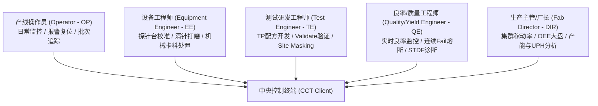
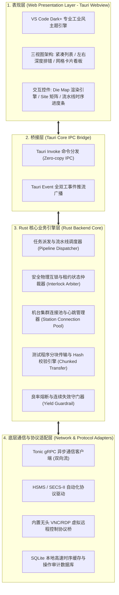
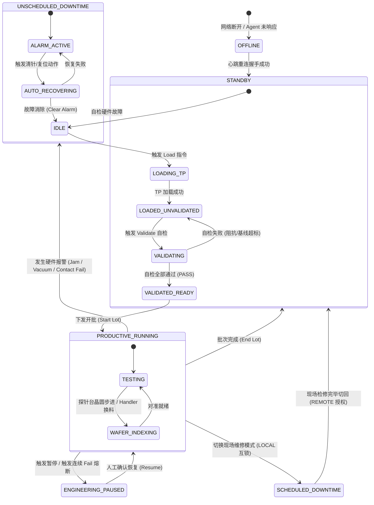
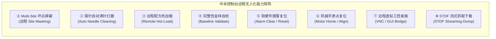
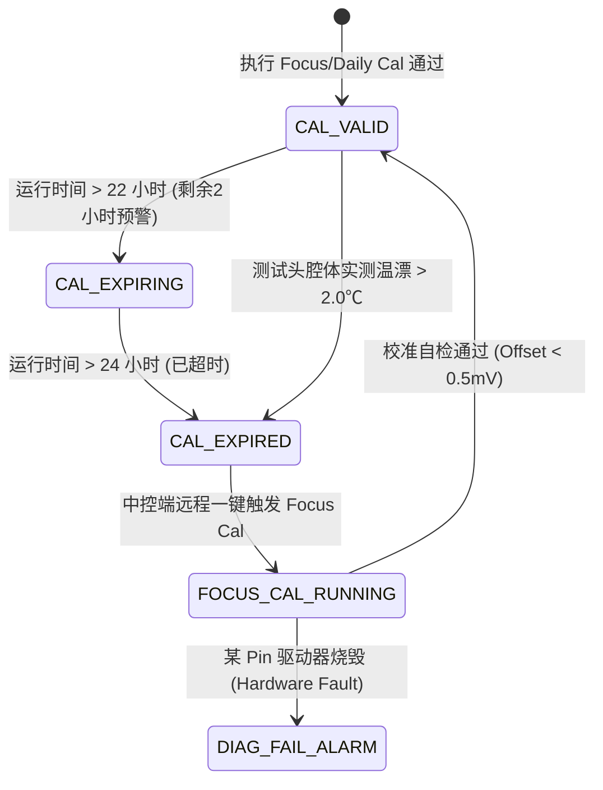
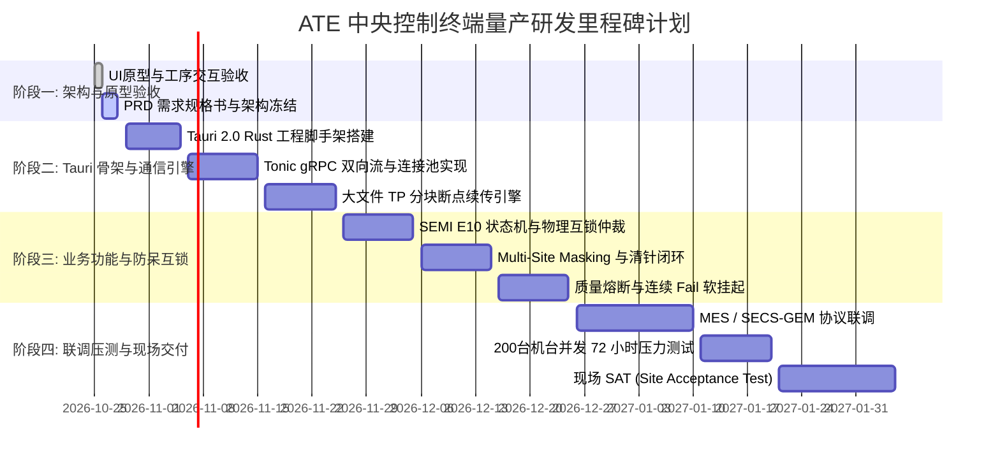

# 芯片半导体 ATE 中央智能控制终端系统 (Central Control Terminal)
## 完整产品需求规格说明书 (Product Requirements Document - PRD)

| 属性 | 内容 |
| :--- | :--- |
| **文档名称** | 芯片半导体 ATE 中央智能控制终端系统产品需求规格说明书 |
| **项目代号** | Project SiliconMaster (ATE-CCT) |
| **文档版本** | v4.0 (Advantest & Teradyne Dual-Standard Edition) |
| **密级** | 企业内部机密 (Confidential) |
| **行业标准对齐** | SEMI E10, SEMI E30 (GEM), SEMI E37 (HSMS), SEMI E87, STDF v4, SmarTest 8 Cal/Diag Standard |
| **产品负责人** | ATE 资深产品架构与测试工程专家团队 (Ex-Advantest & Ex-Teradyne System Architecture) |
| **适用范围** | 晶圆测试厂 (CP Sort / Wafer Probe)、芯片成品测试厂 (FT Test / Final Test)、系统级测试 (SLT) |
| **更新日期** | 2026-10-26 |

---

## 目录 (Table of Contents)
1. [文档变更记录 (Revision History)](#1-文档变更记录-revision-history)
2. [项目背景与战略目标 (Background & Objectives)](#2-项目背景与战略目标-background--objectives)
3. [用户画像与典型作业场景 (Personas & Scenarios)](#3-用户画像与典型作业场景-personas--scenarios)
4. [系统整体架构与网络拓扑 (System Architecture & Topology)](#4-系统整体架构与网络拓扑-system-architecture--topology)
5. [机台物理与逻辑状态机规约 (Machine State Machine Model)](#5-机台物理与逻辑状态机规约-machine-state-machine-model)
6. [详细功能需求规格 (Detailed Functional Requirements)](#6-详细功能需求规格-detailed-functional-requirements)
   - 6.1 [机台全景状态感知与多视图监控子系统](#61-机台全景状态感知与多视图监控子系统)
   - 6.2 [测试程序 (TP) / 配方全生命周期管控引擎](#62-测试程序-tp--配方全生命周期管控引擎)
   - 6.3 [远程无人化高频操作与控制中心](#63-远程无人化高频操作与控制中心)
   - 6.4 [批量任务流水线与并发调度引擎](#64-批量任务流水线与并发调度引擎)
   - 6.5 [硬件安全互锁与物理防呆体系](#65-硬件安全互锁与物理防呆体系)
   - 6.6 [量产质量守门与连续失效智能熔断机制](#66-量产质量守门与连续失效智能熔断机制)
   - 6.7 [Datalog 遥测、STDF 数据流与诊断日志中心](#67-datalog-遥测stdf-数据流与诊断日志中心)
   - 6.8 [爱德万测试头高精密校准与诊断体系 (Cal/Diag Subsystem)](#68-爱德万测试头高精密校准与诊断体系-caldiag-subsystem)
   - 6.9 [超高并测 (16~64+ Sites) 并测一致性与通道方差监控](#69-超高并测-1664-sites-并测一致性与通道方差监控)
   - 6.10 [动态自适应芯片结温控制 (ATC - Active Thermal Control & Tj 监测)](#610-动态自适应芯片结温控制-atc---active-thermal-control--tj-监测)
   - 6.11 [测试头机械微米重力对接互锁 (Direct Docking & Manipulator Interlock)](#611-测试头机械微米重力对接互锁-direct-docking--manipulator-interlock)
   - 6.12 [Hard Bin vs Soft Bin 分级出料模型与 Re-test (2nd Pass) 挽救工序](#612-hard-bin-vs-soft-bin-分级出料模型与-re-test-2nd-pass-挽救工序)
   - 6.13 [SmarTest 8 风格测试套件级定位与 Shmoo 裕量分析支持](#613-smartest-8-风格测试套件级定位与-shmoo-裕量分析支持)
7. [数据字典与接口规约 (Data Schema & API Protocols)](#7-数据字典与接口规约-data-schema--api-protocols)
8. [非功能性需求 (Non-Functional Requirements)](#8-非功能性需求-non-functional-requirements)
9. [基于 Tauri 的客户端技术落地规格 (Tauri Architecture Implementation)](#9-基于-tauri-的客户端技术落地规格-tauri-architecture-implementation)
10. [项目实施里程碑与验收准则 (Milestones & Acceptance Criteria)](#10-项目实施里程碑与验收准则-milestones--acceptance-criteria)

---

## 1. 文档变更记录 (Revision History)

| 版本 | 发布日期 | 修订人 | 修订性质 | 核心修改摘要 |
| :--- | :--- | :--- | :--- | :--- |
| **v1.0** | 2026-10-25 | ATE Architecture | 新建 | 初步确立基于 Tauri 的控制终端概念与简易看板原型。 |
| **v2.0** | 2026-10-26 | Teradyne PM Team | 增强 | 引入测试机/外设/温控分体架构，增加安全互锁与 Site Masking 概念。 |
| **v3.0** | 2026-10-26 | Senior Lead PM | 重大重构 | 全面展开为工业级完整 PRD：补充 SEMI E10 状态机、多通道 Site 调度、MES 三码防呆闭环、连续失效熔断机制、Tauri Rust 底层通信协议与全套数据字典。 |
| **v4.0** | 2026-10-26 | Advantest Test Specialist | 深度升级 | **爱德万标准引入**：增加测试头校准（Focus/Daily Cal）24h硬互锁防伪缺陷、超高并测（16~64 Sites）通道良率方差监控、大功率芯片动态自适应结温控制（ATC $T_j$）、重力 Direct Docking 微米锁止、Hard/Soft Bin 出料模型与 Re-test 挽救工序。 |

---

## 2. 项目背景与战略目标 (Background & Objectives)

### 2.1 行业现状与量产痛点
在半导体晶圆探针测试（CP - Circuit Probe）与成品测试（FT - Final Test）车间中，万级与千级洁净室（Cleanroom）的人员进出受到极其严格的穿戴与风淋管控。当前行业痛点如下：

1. **人员往返巡检损耗严重 (High Walk-around Latency)**：
   - 一名技术员通常负责 10~20 台 ATE 站台。机台报警后，依靠视觉观察物理三色灯柱，平均响应延迟达 8~15 分钟，严重降低机台利用率（OEE）。
2. **转产换批人工作业风险极高 (Wrong Recipe Scrap Risk)**：
   - 切换测试批次时，依赖技术员插拔防静电 U 盘逐台拷贝测试程序（TP - Test Program）。半导体行业每年因人为选错程序版本、打错测试向量造成的批量报废损失动辄数百万美元。
3. **分体机台故障定位困难 (Fragmented Sub-unit Troubleshooting)**：
   - 一套 ATE 站台包含测试机柜（Tester）、探针台/分选机（Prober/Handler）、温控箱（Chiller）。以往中控系统仅采集总线联锁信号，无法细分具体是探针氧化、吸盘真空泄压，还是温控漂移，技术员依然必须亲临现场逐一排查。
4. **多通道并测异常处理成本高 (Multi-Site Yield Collapse)**：
   - 现代 ATE 普遍采用 8/16/32 并测。当某单一 Site（如 Site 3）硬件损坏（如探针断裂、接触电阻超标），缺乏远程快速屏蔽手段，导致整台设备停机或连续拉低总良率。

### 2.2 核心业务与技术目标 (OKRs)
* **业务目标 (Business Objectives)**：
  - **转产工时缩减**：集群测试程序分发与加载验证时间由单台 15 分钟降至集群 30 秒内（提升效率 95% 以上）。
  - **零失误换产 (Zero-defect Changeover)**：实现 MES 工单、本地 TP 程序包、机台底层驱动的 100% 自动 Hash 交叉验证，彻底杜绝混批与错打程序。
  - **洁净室少人化 (Lights-out Operation)**：实现 95% 常见硬件告警（探针清针、通道屏蔽、驱动复位、报警清除）远程闭环处置，单技术员机台管辖能力从 15 台提升至 60 台。
* **系统性能目标 (System Performance Objectives)**：
  - 支持单控制端并发稳定连接 **200+ ATE 站台**。
  - 遥测数据推流延迟 **$\le 200\text{ ms}$**，报警上报至中控端弹屏时间 **$\le 100\text{ ms}$**。
  - 大文件 TP 程序包（100MB~2GB 向量包）分块断点续传成功率 **$\ge 99.999\%$**。

---

## 3. 用户画像与典型作业场景 (Personas & Scenarios)

### 3.1 核心用户角色定义 (User Personas)



| 角色分类 | 核心痛点与需求 | 在本系统中的高频使用功能 |
| :--- | :--- | :--- |
| **产线操作员 (OP)** | 需要实时知晓哪台机停机了，能快速知道错误原因，一键复位恢复生产。 | 状态看板、实时报警列表、一键批次开批/结批、一键故障复位。 |
| **设备工程师 (EE)** | 频繁需要监控探针扎针寿命、吸盘真空度、温控浸润状态，不想反复进洁净室。 | 探针扎针计数监控、远程一键触发清针打磨、温控 Soak 状态监控、真空监测。 |
| **测试工程师 (TE)** | 新版本 TP 上线、转产下发、点检验证、通道故障应急处理。 | TP 程序上传与并发分发、Load/Validate 流水线、Multi-Site 坏点屏蔽。 |
| **良率工程师 (QE)** | 担心连续 Fail 导致整批报废，需要看实时的 Die Map 与 Binning 分布。 | 晶圆 Die Map 缺陷分布、连续失效防损熔断规则设定、STDF 流式抓取。 |
| **生产厂长 (DIR)** | 宏观掌握全车间实时 UPH、良率大盘、在线机台健康度分布。 | 全局综合统计 Header、产线 UPH 聚合指标、OEE 稼动率看板。 |

### 3.2 典型全生命周期业务场景 (Operational Scenarios)

#### 场景 A：无感批次转产与自动化热重载 (Batch Recipe Changeover)
1. **触发**：MES 下发转产任务单，Lot `LOT-20261026-X` 晶圆抵达 CP 车间 1 区（包含 ST-01 ~ ST-04 四台探针台）。
2. **操作**：TE 在中控台选择对应的 4 台机台，点击「上传并分发 TP」。
3. **系统闭环**：
   - 终端调取 MES API 比对该批次工艺所绑定的程序包名与 MD5/SHA-256。
   - 终端并发向 4 台机台底层 Agent 流式推送程序包，机台本地写入高速固态并完成校验。
   - 终端自动化驱动测试机执行内存动态卸载与新程序载入（Load）。
   - 自动化触发基线阻抗、数字板卡 Loopback 自检与 Golden Die 仿真比对（Validate）。
4. **结果**：全流程 25 秒完成，四台机台状态从蓝色转换为绿色 `READY`，操作员无需进入洁净室。

#### 场景 B：探针卡 Pin 损坏与紧急远程屏蔽 (Remote Site Masking)
1. **触发**：ST-02 探针台正在进行 8-Site 并行测试，QE 大盘报警发现 Site 3 连续 10 颗 Die 出现 `Open/Short Fail`，而其他 7 个 Site 良率 99.8%。
2. **排查**：TE 打开 ST-02 诊断弹窗，查看 Multi-Site 面板，确认 Site 3 硬件接触不良。
3. **处置**：TE 鼠标点击 Site 3，选择 `Mask (屏蔽)`，并输入备注原因。
4. **系统闭环**：终端向 ST-02 的 IG-XL / ATE 驱动下发 `SET_ACTIVE_SITES [1,2,4,5,6,7,8]`。机台即刻在下一次 Touchdown 时跳过 Site 3 数据采集与测试。
5. **收益**：避免了停机换卡长达 2 小时的停线损失，其余 7 个通道继续高产出运转。

#### 场景 C：探针氧化阻抗超标与远程清针恢复 (Probe Auto-cleaning)
1. **触发**：ST-02 触发告警停机，错误码 `ERR_PROBE_CONTACT_RESISTANCE_HIGH (0x004F)`，Pin#128 接触阻抗达 3.82$\Omega$（门限 $\le 1.20\Omega$）。
2. **处置**：EE 在中控台点击 `[执行自动清针动作]`。
3. **系统闭环**：
   - 终端通知 Prober 机械臂前往机台内部预置的研磨垫（Lapping Pad）。
   - 机械臂执行 5 次微米级步进研磨打磨，清除针尖沾附的硅渣与氧化层。
   - 打磨完毕后探针台自动压测金样基准点，复测阻抗为 0.42$\Omega$。
   - 终端收到成功报文，自动清除告警，机台恢复 `RUNNING` 生产态。

---

## 4. 系统整体架构与网络拓扑 (System Architecture & Topology)

### 4.1 物理与网络部署拓扑 (Network Topology)

```mermaid
flowchart TB
    subgraph Fab_MES_Infra["晶圆厂生产管理网络 (Fab IT/OT Backbone)"]
        MES["MES 制造执行系统<br/>(工单/配方防呆校验)"]
        EAP["EAP / SECS-GEM 主机<br/>(SEMI 通信网关)"]
        YMS["YMS 良率管理系统<br/>(STDF / Datalog 解析)"]
    end

    subgraph Central_Console["中央主控机房 (Cleanroom Central Control Room)"]
        Master_App["ATE 中央智能控制终端 (Tauri Desktop App)<br/>- Rust 高性能异步并发引擎 (Tokio + Tonic)<br/>- 本地嵌入式数据引擎 (SQLite + RocksDB Cache)<br/>- 实时前端响应层 (Tailwind + Canvas Die Map)"]
    end

    subgraph Cleanroom_Bays["洁净室机台集群 (Cleanroom Industrial LAN - 10Gbps)"]
        subgraph Station_1["ATE 站台 #1 (ST-01)"]
            Agent_1["Station Agent (C++/Rust 边缘守护进程)"]
            Tester_1["Tester 测试机柜 (Teradyne/Advantest)"]
            Prober_1["Prober 晶圆探针台 (TEL/Accretech)"]
            Chiller_1["Thermal 温控单元 (Thermonics)"]
            Agent_1 <--> Tester_1
            Agent_1 <--> Prober_1
            Agent_1 <--> Chiller_1
        end

        subgraph Station_2["ATE 站台 #2 (ST-02)"]
            Agent_2["Station Agent"]
            Tester_2["Tester 测试机柜"]
            Handler_2["Handler 成品分选机 (Hontech/Chroma)"]
            Chiller_2["Thermal 温控单元"]
            Agent_2 <--> Tester_2
            Agent_2 <--> Handler_2
            Agent_2 <--> Chiller_2
        end

        subgraph Station_N["ATE 站台 #N (ST-N ... 200+)"]
            Agent_N["Station Agent ..."]
        end
    end

    Master_App <-->|RESTful / HTTPS| MES
    Master_App <-->|HSMS / SECS-II| EAP
    Master_App -->|STDF 流归档| YMS

    Master_App <===>|gRPC 双向流 (遥测+控制指令)| Agent_1
    Master_App <===>|gRPC 双向流 (遥测+控制指令)| Agent_2
    Master_App <===>|gRPC 双向流 (遥测+控制指令)| Agent_N

    Master_App -.->|Chunked TCP 流式直传大文件 TP| Agent_1
    Master_App -.->|Chunked TCP 流式直传大文件 TP| Agent_2
```

### 4.2 软件分层架构设计 (Software Architecture Layers)



---

## 5. 机台物理与逻辑状态机规约 (Machine State Machine Model)

系统严格遵循半导体 **SEMI E10 (Standard for Definition and Measurement of Equipment Reliability, Availability, and Maintainability)** 工业状态定义，并映射为中控操作态：



### SEMI E10 状态编码对照表
| 中控系统状态字 | SEMI E10 分类 | 状态颜色 (VS Code 配色) | 允许的远程中控操作 |
| :--- | :--- | :--- | :--- |
| `PRODUCTIVE_RUNNING` | PR (Productive Time) | `#73c991` (健康绿) | 暂停测试、紧急停机、查看实时遥测、抓取 STDF |
| `VALIDATED_READY` | SBY (Standby) | `#007acc` (信息蓝) | 下发开批 (Start Lot)、卸载程序、热重载 TP |
| `IDLE_UNVALIDATED` | SBY (Standby) | `#cca700` (警示黄) | 下发 Load、下发 Validate、执行自检诊断 |
| `ALARM_ACTIVE` | UDT (Unscheduled Downtime) | `#f14c4c` (故障红) | 远程打磨清针、复位报警、重新校准、重启进程 |
| `LOCAL_MAINTENANCE` | SDT (Scheduled Downtime) | `#e5b567` (互锁金) | **禁止任何危险动作**；仅允许查看传感器与释放租约 |
| `OFFLINE` | NST (Non-scheduled Time) | `#858585` (离线灰) | 触发重连握手、网络诊断、查看历史离线日志 |

---

## 6. 详细功能需求规格 (Detailed Functional Requirements)

### 6.1 机台全景状态感知与多视图监控子系统

#### 6.1.1 三位一体子设备深度监控规范 (Sub-unit Telemetry)
系统要求对每个 ATE 站台实现分体下钻监控：
1. **测试机主机单元 (Tester Sub-unit)**：
   - 通信 IP/端口、测试机操作系统版本（如 RedHat Enterprise Linux ATE OS）。
   - 数字板卡温度、模拟精密源表（SMU）校准有效期、供电母线电压稳定性。
   - 当前加载测试程序名称、程序版本、MD5 / SHA-256 签名。
   - Datalog 数据流开启状态（`STDF Streaming: ON/OFF`）。
2. **探针台/分选机单元 (Prober/Handler Sub-unit)**：
   - 晶圆吸盘/芯片托盘真空负压（限定阈值：$-95.0\text{ kPa} \sim -88.0\text{ kPa}$，低于 $-85.0\text{ kPa}$ 自动联锁报警）。
   - 探针卡累计扎针计数（Touchdown Counter）与清针循环余量（如 28,950 / 30,000）。
   - 分选机机械手 X/Y/Z 轴伺服电机负载率与 Socket 磨损度。
   - 硬件微动开关状态：前安全门（Door Interlock）、研磨抽屉位置。
3. **环境与温控单元 (Thermal Chamber/Chiller Sub-unit)**：
   - 实测测试腔温度与目标设定温度（支持三温量产：$-40^\circ\text{C}$ 低温 / $25^\circ\text{C}$ 常温 / $125^\circ\text{C}$ 高温）。
   - 温度容限保护门限（$\pm 1.5^\circ\text{C}$ 超差自动联锁）。
   - 浸温倒计时（Soak Time Timer）：换批或换盘后必须浸温达到规定时间方可允许发码开测。

#### 6.1.2 监控界面三视图架构设计
1. **紧凑列表视图 (Compact Table View - 默认生产视图)**：
   - 高密度展示，单屏容纳 25~30 台机台，支持按机台 ID、运行状态、良率快速排序与模糊搜索。
   - 支持表格首列 Checkbox 多选，勾选机台后底部滑出浮动操作栏（Batch Action Bar）。
   - 每一行内置三合一状态微型胶囊指示：`[TST:RUN]` `[PRB:OK]` `[THM:23.8℃]`，一眼区分故障源。
2. **左右分栏排错视图 (Split Inspector View - 工程师诊断视图)**：
   - 左侧为可滚动的机台列表（带状态红绿灯与实时良率）；
   - 右侧为主详情排错工作台，动态展示实时晶圆 Die Map（缺陷点阵）、详细报警建议、传感器仪表盘与快捷排错动作。
3. **网格卡片矩阵视图 (Matrix Grid View - 大屏监视视图)**：
   - 采用标准 4 列响应式卡片流，适合洁净室悬挂式 4K 监视大屏。
   - 包含实时良率进度条、UPH 速率计数器、控制权角标（`REMOTE` / `LOCAL🔒`）。

---

### 6.2 测试程序 (TP) / 配方全生命周期管控引擎

#### 6.2.1 工业防呆流水线 (Fool-Proofing Pipeline)
测试程序的下发执行必须严格遵循以下三阶段串联控制：

```mermaid
sequenceDiagram
    autonumber
    actor TE as 测试工程师 (中控台)
    participant CCT as CCT 中控端 (Tauri)
    participant MES as 工厂 MES 系统
    participant Agent as 机台 Station Agent
    participant Tester as ATE 底层驱动 (IG-XL)

    TE->>CCT: 选择机台集群，点击「导入并分发新 TP」
    CCT->>MES: 发起工艺防呆校验 (Lot ID vs TP Recipe Name)
    MES-->>CCT: 返回校验结果 (Check: PASS, Checksum: a591a6...)
    
    rect rgb(20, 45, 66)
        note right of CCT: 阶段 1: Chunked Push (分块流式传输)
        CCT->>Agent: 创建分发会话 (Session ID, File Size, Total Chunks)
        loop 循环发送数据分块 (64KB ~ 1MB)
            CCT->>Agent: 推送分块字节流 (Chunk Index, Payload, CRC32)
            Agent-->>CCT: ACK 确认
        end
        Agent->>Agent: 组装文件并执行 SHA-256 全量核验
        Agent-->>CCT: Push 成功，指纹一致
    end

    opt 管道勾选了: 通知机台 Load
        rect rgb(30, 50, 40)
            note right of CCT: 阶段 2: Runtime Memory Load (内存载入)
            CCT->>Agent: 指令: LOAD_RECIPE_MEMORY(Recipe Path)
            Agent->>Tester: 调用测试机 API 加载测试向量与模式表
            Tester-->>Agent: 驱动加载就绪 (Loaded v4.2)
            Agent-->>CCT: 状态更新: LOADED_UNVALIDATED
        end
    end

    opt 管道勾选了: 通知机台 Validate
        rect rgb(50, 40, 20)
            note right of CCT: 阶段 3: Baseline & Correlation Validate (点检自检)
            CCT->>Agent: 指令: EXECUTE_VALIDATE_DIAGNOSTICS()
            Agent->>Tester: 触发测试机板卡自检 & 探针基线阻抗扫描
            Agent->>Tester: 执行虚拟 Golden Die 仿真比对
            Tester-->>Agent: 点检合格: Loopback OK, Pin Res < 1.0Ω
            Agent-->>CCT: 状态更新: VALIDATED_OK (机台解除锁定)
        end
    end

    CCT->>TE: 弹出气泡通知: 集群 TP 下发与自检成功完成
```



#### 6.2.2 详细规则规约
1. **断点续传与重试机制**：传输大文件（如 2GB 以上的高速数字向量）过程中若网络闪断，Agent 端保留已接收分块，网络恢复后从断点分块继续传输，超过 5 次重试失败则自动回滚清理临时文件。
2. **强制未验证锁定 (Unvalidated Lockout)**：凡是接收到新 TP 文件或执行过 `Load` 的机台，系统必须在内存中强制将其标记为 `UNVALIDATED`。在此状态下，屏蔽所有上位机与本地的开测请求，**唯有通过 `Validate` 自检合格方可解除锁定**。

---

### 6.3 远程无人化高频操作与控制中心

针对现场工程师最常离开中控室进入洁净室的 8 大痛点操作，系统在软件层全部实现远程闭环能力：



#### 6.3.1 多通道并测远程屏蔽规格 (Multi-Site Masking)
- **业务意义**：当 8 并测站台的 Site 3 探针损坏时，传统方式必须全机停机等待换针。中控端提供通道动态 Mask 功能。
- **操作规则**：
  - 在机台排错弹窗中提供 `Site 1 ~ Site N` 矩阵网格按钮；
  - 正常通道显示绿色 `PASS`；异常通道显示红色呼吸灯 `FAIL`；被屏蔽通道显示灰色删除线 `MASKED`。
  - 点击故障 Site 即可发送 `MASK_SITE(id)` 指令；机台底层 Agent 调用驱动禁用该通道激励信号与数据采集，其余通道继续跑测。
  - 界面显示实时活跃通道比率（如 `激活: 7/8 Sites`），并记录审计日志入库。

#### 6.3.2 探针自动打磨清针规格 (Needle Cleaning)
- **触发模式**：
  1. **手动一键触发**：技术员发现接触阻抗超标告警时，点击 `[探针打磨清针]`。
  2. **寿命阈值自动触发**：当扎针计数达到设定周期（如每 2,000 次），机台自动在换片间隙插入清针动作。
- **动作执行流**：
  - 指令 Prober 移动 Chuck 前往打磨垫基准位置；
  - 依据预设模板执行 5~10 次微动下压研磨（Overdrive 参数由配方严格指定，如 $35\mu\text{m}$）；
  - 研磨完毕自动对机内基准金样进行四线制阻抗量测；
  - 阻抗恢复到 $\le 1.0\Omega$ 自动向中控端回传清针成功报文，重置清针周期计时器。

#### 6.3.3 远程虚拟屏幕直连 (Virtual Console / VNC Bridge)
- **规格**：对于某些极其罕见的深层算法调试，技术员无需走到机台拉出键盘抽屉。系统内嵌轻量级 VNC / WebRTC 客户端，可直接在中控台弹窗映射机台工控机的 Linux / Windows 图形桌面，延迟控制在 $150\text{ ms}$ 内。

---

### 6.4 批量任务流水线与并发调度引擎

#### 6.4.1 ATE 专属批量任务模板库 (Task Templates)
系统内置 6 大半导体专属批量任务模板：
1. **`TASK-CHANGEOVER` (TP测试程序热加载与转产)**：并发推送指定 Recipe，重置 Lot ID、清除良率计数器并加载驱动内存。
2. **`TASK-VALIDATE` (TP完整性与金样自检)**：批量发送握手诊断，执行板卡 Loopback 自检与阻抗校验。
3. **`TASK-PROBE-CLEAN` (探针打磨清针与阻抗复测)**：批量驱使探针台机械臂执行指定次数的研磨打磨循环。
4. **`TASK-OPTICS-CALIB` (AOI 光学镜头标定与寻边)**：批量触发物镜白平衡校正、自动对焦寻边与晶圆 Mark 点对齐。
5. **`TASK-ALARM-RESET` (故障告警复位与驱动重启)**：并发清除机台挂起错误字，软重启 Agent 本地服务守护进程。
6. **`TASK-LOG-DUMP` (诊断日志与波形导出)**：并发抓取指定时间窗口内的 10,000 条事件日志与阻抗波形并打包压缩下载。

#### 6.4.2 调度并发控制模式 (Concurrency Strategies)
- **全机并行并发模式 (Full Parallel)**：通过异步协程池同时向下发所有选中的机台广播指令，执行速度最快，适用于紧急停机、批次下发。
- **逐台串行灰度模式 (Rolling Canary)**：第一台机台执行成功并通过 Validate 自检后，才自动化推进剩余机台；一旦首台失败立即中断流水线，保护其余机台不被异常程序污染。

---

### 6.5 硬件安全互锁与物理防呆体系

在半导体厂房中，安全高于一切。系统必须在软件逻辑层建立不可逾越的物理安全互锁：

```mermaid
flowchart TD
    Req["中控端下发操作指令<br/>(Load / Start / Clean / Reset)"] --> Check_Mode{"机台控制权模式<br/>(Control Mode)"}

    Check_Mode -->|处于 LOCAL 模式| Deny["【安全互锁硬阻断】<br/>1. 弹出警告模态弹窗<br/>2. 按钮强制置灰禁用<br/>3. 记录违规操作审计日志"]
    
    Check_Mode -->|处于 REMOTE 模式| Check_Sensors{"物理传感器联锁检查<br/>(Hardware Interlocks)"}

    Check_Sensors -->|安全门开 / 真空低 / EMO拍下| Interlock_Alarm["【物理硬件联锁触发】<br/>阻断下发并上报机台联锁故障"]

    Check_Sensors -->|全部合规 (Normal)| Check_Lease{"控制权租约是否由本端持有?"}

    Check_Lease -->|未持有 / 被其他终端占用| Conflict["【租约冲突】提示当前机台正被其他工程师操控"]

    Check_Lease -->|持有合法租约| Execute["通过 gRPC 通道正式下发机台驱动执行"]
```

#### 6.5.1 控制权租约仲裁规则 (Control Ownership Lease)
1. **机台物理钥匙优先级最高**：机台电箱上的物理钥匙转到 `LOCAL` 位时，机台硬件 PLC 会断开远程写入总线。此时中控终端必须立即显示 `🔒 LOCAL` 徽章，并锁定所有远程控制按键。
2. **远程租约互斥性**：多台终端同时连接时，同一时间仅允许一个终端账号对特定机台发起控制动作，其余终端自动降级为只读观察模式（Observer Mode）。

---

### 6.6 量产质量守门与连续失效智能熔断机制

为了彻底杜绝由于探针崩针、对位偏位造成的连续报废整片晶圆事故，系统集成实时质量熔断看门狗（Yield Quality Guardrail）：

#### 6.6.1 连续同 Bin 失效拦截 (Consecutive Same-Bin Fail Interlock)
- **规则定义**：当同一站点在连续 $K$ 颗（默认 $K=3$）测试芯片中连续出现相同的失效 Bin 码（如连续 3 颗出现 `Bin 2: Contact Open Fail`）：
- **系统动作**：
  1. 中控端瞬间向机台下发 `INTERRUPT_PAUSE` 软挂起指令；
  2. 机台探针台立即脱离与晶圆的接触（Z 轴抬升 $500\mu\text{m}$），停止后续测试；
  3. 中控台发出高优先级视听警报，并在 Die Map 上以高亮红圈标注故障点；
  4. 必须由具备工程师以上权限的用户在排查确认后手动输入工号复核方可解除挂起。

#### 6.6.2 动态良率底线熔断 (Dynamic Yield Threshold)
- 配方内配置基准良率下限（例如 98.0%）。
- 晶圆测试超过 200 颗 Die 后，若实时综合良率跌破下限，系统自动触发 `LOW_YIELD_ALARM`，并弹窗提示是否执行自动化探针打磨或通知 QE 进场复验。

---

### 6.7 Datalog 遥测、STDF 数据流与诊断日志中心

#### 6.7.1 STDF v4 标准数据格式集成规范
- **数据规范**：系统遵循 **SEMI STDF v4 (Standard Test Data Format)** 规范，采集以下核心数据记录：
  - `MIR` (Master Information Record)：批次号、晶圆号、测试程序版本、操作员工号。
  - `PMR` (Pin Map Record)：测试机通道与探针卡物理 Pin 对应拓扑。
  - `PRR` (Part Result Record)：每颗芯片的 X/Y 坐标、Hard Bin、Soft Bin、测试用时（Test Time，单位：ms）。
  - `FTR` (Functional Test Record)：具体故障失效向量与向量周期步数。
- **流式抓取**：客户端支持以流式方式直读机台 Agent 输出的压缩 `.stdf.gz` 数据，并提供一键导出为 CSV/Excel。

#### 6.7.2 晶圆 Die Map 缺陷分布渲染引擎
- 前端内建 Canvas 高性能点阵渲染器，支持单片 $200\text{mm} / 300\text{mm}$ 晶圆上包含多达 **100,000 颗微型 Die** 的毫秒级无卡顿重绘。
- 颜色规约：
  - `Bin 1 (Pass)`：标准工业绿 `#73c991`；
  - `Bin 2~8 (Hard Fail)`：告警红 `#f14c4c`；
  - `Marginal (复测点)`：警示黄 `#cca700`；
  - 未测试区域：深灰 `#2d2d2d`。

---

### 6.8 爱德万测试头高精密校准与自检诊断体系 (Cal/Diag Subsystem)

#### 6.8.1 业务背景与测试物理学挑战
在爱德万 V93000（如 EXA Scale 平台）与 T5833 存储器测试系统中，测试硬件由成百上千张高速数字板卡（Pin Electronics - PE）、精密源表（SMU）及高速差分收发器构成。
* **物理温漂**：测试头内部温度每波动 $1.5^\circ\text{C}$，板卡通道 DC 失调电压漂移可达 $2\text{ mV}$，高频线缆时延漂移达 $15\text{ ps}$。对于运行在 $1.2\text{ GHz} \sim 6.4\text{ Gbps}$ 的先进制程芯片，微小的时延漂移会造成原本良品的芯片被误判为 Fail（产生严重的 **伪缺陷 False Fail**，使测试厂遭受重大赔偿纠纷）。
* **校准体系定义**：
  1. **Focus Cal（聚焦自校准）**：耗时 60~90 秒，对测试机所有激活 Pin 的比较器门限与失调电压进行原位自闭环补偿。
  2. **Daily Cal（每日例行全校准）**：耗时 5~10 分钟，利用机台内建精密校准单元（CAL-Board）进行时域反射计（TDR）线缆时延全通道补偿。

#### 6.8.2 中控端 Cal/Diag 状态机与量产硬互锁

* **硬阻断规则 (Mandatory Cal Guardrail)**：
  - 凡是处于 `CAL_EXPIRED` 状态的机台，**中控端必须在逻辑层硬性锁定该机台的 `Load Recipe` 与 `Start Lot` 权限**！
  - 弹出警示模态弹窗，提示：“机台测试头校准已过期，禁止加载量产程序，请先点击 `[Focus Cal]` 进行自校准。”

---

### 6.9 超高并测 (16~64+ Sites) 并测一致性与通道方差监控

#### 6.9.1 爱德万超高并测规模支持
在内存（DRAM/NAND）与高性能 SoC 测试中，机台普遍采用 16/32/64/128 并测。中控端必须摆脱传统 8 通道固定写死的限制，提供具备**自适应折叠/展开**的超高并测网格。

#### 6.9.2 通道良率方差告警算法 (Site-to-Site Variation)
在 ATE 测试中，若芯片真伪由工艺决定，各 Site 的良率应服从正态分布。若某一通道良率显著偏离均值，说明存在**机械倾斜（Tilt）或单通道 Socket 接触不良**：
$$\bar{Y} = \frac{1}{N}\sum_{i=1}^N Y_i, \quad \sigma_{\text{site}} = \sqrt{\frac{1}{N}\sum_{i=1}^N (Y_i - \bar{Y})^2}$$
* **通道方差告警准则**：
  - 当 $\sigma_{\text{site}} > 2.5\%$ 且测试颗粒数 $> 500\text{ ea}$ 时，中控系统触发 **`SITE_VARIATION_ALARM`**；
  - 界面自动以橙色高亮偏离均值最大的通道（如 Site 3 良率 71.4%，全机平均良率 98.5%）；
  - 弹窗推荐技术员执行该通道的 **Site Mask (临时远程屏蔽)**，待批次结批后再进场调校探针卡水平度。

---

### 6.10 动态自适应芯片结温控制 (ATC - Active Thermal Control & $T_j$ 监测)

#### 6.10.1 传统恒温箱 vs 爱德万现代 ATC 差异
* **传统模式缺陷**：仅监控温箱气温（如 $24.0^\circ\text{C}$）。但现代 AI / GPU 芯片在运行测试向量（Pattern）时瞬间功耗可达 $300\text{W} \sim 800\text{W}$，芯片内部结温（Junction Temperature, $T_j$）会在数毫秒内急剧飙升至 $110^\circ\text{C}$ 以上，造成热击穿损坏。
* **ATC 智能温控规格**：
  - 客户端通过底层 Agent 实时读取芯片片上热敏二极管（Thermal Diode）反馈的当前实测结温 $T_j$；
  - 监控 ATC 液冷压头（Thermal Head）的动态响应余量与实时流速；
  - **热过载保护熔断**：设定动态保护门限（如 $T_j \le 105.0^\circ\text{C}$），一旦测试向量执行期间 $T_j$ 突发超标，立即向测试机发送 `ABORT_VECTOR`，防止烧毁昂贵的晶圆裸片。

---

### 6.11 测试头机械微米重力对接互锁 (Direct Docking & Manipulator Interlock)

#### 6.11.1 物理对接安全规范
爱德万 V93000 测试头重量通常在 $600\text{ kg} \sim 1.5\text{ 吨}$。测试头通过大型悬臂机械手（Manipulator）与探针台（Prober）或分选机（Handler）进行直驱对接（Direct Docking）。
* **对接状态传感感知**：
  1. `DOCKED_LOCKED`：重力定位销完全就位，气动微动微米锁牢固锁紧，对中容差 $\le 3\mu\text{m}$。
  2. `DOCKING_IN_PROGRESS`：悬臂正在升降微调对接中，测试头高压电源强制切断。
  3. `UNDOCKED`：测试头处于脱离状态（离线维护）。
* **中控端联锁策略**：未处于 `DOCKED_LOCKED` 状态前，严禁下发任何测试向量执行（Run Test）或探针下压（Touchdown）指令。

---

### 6.12 Hard Bin vs Soft Bin 分级出料模型与 Re-test (2nd Pass) 挽救工序

#### 6.12.1 软硬 Bin 分类规约
系统遵循行业标准，对测试结果建立级联双层 Binning 映射：
1. **Hard Bin（物理分选出料 Bin，1~8 或 1~16）**：
   - 对应分选机物理出料轨道或物理收纳 Tray 盘。例如：
     - `Bin 1`：完全合格正品 (Pass)；
     - `Bin 2`：开路短路接触不良 (Contact Fail)；
     - `Bin 3`：微安级静态漏电超标 (Leakage Fail)；
     - `Bin 4`：数字逻辑/BIST 核心功能失效 (Functional Fail)。
2. **Soft Bin（软件缺陷根因 Bin，1~256）**：
   - 记录具体精确失效指标（如 `SoftBin 104: PLL Jitter > 12ps`, `SoftBin 201: DDR5 Read Eye Margin Collapse`），供设计工程师进行失效分析（FA）。

#### 6.12.2 晶圆级二次重测挽回工序 (Re-test / 2nd Pass Recovery)
在晶圆测试中，由于探针卡针尖附着微粉氧化物，部分原本良品的芯片可能在第一次压测（1st Pass）中被误判为 Contact Fail。
* **中控端必须支持记录并计算**：
  - **1st Pass 良率**（如 97.4%）；
  - **Re-test 挽回良率**（经过自动清针打磨后原位二次重测，良率回升 +1.7%）；
  - **最终合并出货良率**（Final Yield: 99.1%）；
  - 自动绘制 Re-test 挽回漏斗图，供 QE 评估探针卡损耗速率。

---

### 6.13 SmarTest 8 风格测试套件级定位与 Shmoo 裕量分析支持

#### 6.13.1 测试套件执行流定位 (Test Suite Failure Breakdown)
爱德万 SmarTest 8 测试程序由模块化的 Test Suites 串联而成。中控端在机台报停时，绝不仅显示笼统的“Error”，而是必须精确回显失效的上下文：
* **失效套件名称**：例如 `TS_CoreLogic_AtSpeed_1.2GHz`；
* **测试条件参数**：`VDD = 0.75V, Temp = 25℃, Clock = 1200MHz`；
* **失效向量周期与引脚**：`Vector Cycle #409,210, Pin: D14 (Data Pin)`。

#### 6.13.2 远程 Shmoo 裕量扫描调度支持
* 针对处于工程调试状态的机台，测试工程师可直接在中控台右键发起 `Shmoo Plot` 二维电压-频率（VDD vs Frequency）裕量扫描任务；
* 测试机在后台自动以步进电压扫描执行，中控端以轻量级热力图直观返回该批次芯片的通过边缘（Pass/Fail Margin Cliff），无需技术员去洁净室打开工控机。

---

## 7. 数据字典与接口规约 (Data Schema & API Protocols)

### 7.1 机台聚合实体数据结构 (Station Data Schema - v4.0 爱德万双标准扩充)

```json
{
  "$schema": "http://json-schema.org/draft-07/schema#",
  "title": "AteStationEntity",
  "type": "object",
  "properties": {
    "station_id": { "type": "string", "example": "ST-02" },
    "station_name": { "type": "string", "example": "晶圆探针台 (CP Prober #2)" },
    "station_type": { 
      "type": "string", 
      "enum": ["AOI-Optics", "CP-Prober", "FT-ATE", "Defect-Review", "3D-Surface"] 
    },
    "cal_status": {
      "state": { "type": "string", "enum": ["VALID", "EXPIRING", "EXPIRED"], "example": "VALID" },
      "valid_hours_remaining": { "type": "number", "example": 14.5 },
      "last_cal_timestamp": { "type": "string", "example": "今日 06:30" },
      "pe_dc_offset_mv": { "type": "number", "example": 0.42 },
      "tdr_cable_jitter_ps": { "type": "number", "example": 4.8 }
    },
    "docking_status": {
      "type": "string",
      "enum": ["LOCKED", "DOCKING_IN_PROGRESS", "UNDOCKED"],
      "example": "LOCKED"
    },
    "atc_thermal": {
      "current_tj_c": { "type": "number", "example": 82.6 },
      "target_tj_c": { "type": "number", "example": 80.0 },
      "max_tj_limit_c": { "type": "number", "example": 105.0 },
      "atc_liquid_flow_lpm": { "type": "number", "example": 3.8 }
    },
    "hard_bins": {
      "type": "array",
      "items": {
        "bin": { "type": "integer", "example": 1 },
        "name": { "type": "string", "example": "PASS" },
        "count": { "type": "integer", "example": 1317 },
        "pct": { "type": "number", "example": 94.10 }
      }
    },
    "active_test_suite": {
      "suite_name": { "type": "string", "example": "TS_Contact_Continuity_Check" },
      "fail_vector_cycle": { "type": "integer", "example": 409210 },
      "fail_pin": { "type": "string", "example": "Pin#128/129" }
    },
    "retest_metrics": {
      "first_pass_yield": { "type": "number", "example": 92.40 },
      "retest_recovered_count": { "type": "integer", "example": 24 },
      "final_yield": { "type": "number", "example": 94.10 }
    },
    "network": {
      "ip": { "type": "string", "example": "192.168.1.102" },
      "port": { "type": "integer", "example": 5020 },
      "latency_ms": { "type": "number", "example": 1.2 }
    },
    "semi_e10_status": {
      "type": "string",
      "enum": ["PR", "SBY", "ENGR", "UDT", "SDT", "NST"],
      "example": "UDT"
    },
    "control_authority": {
      "mode": { "type": "string", "enum": ["REMOTE", "LOCAL"], "example": "REMOTE" },
      "lease_holder": { "type": "string", "example": "TERMINAL_NODE_01" },
      "interlock_door_closed": { "type": "boolean", "example": true },
      "interlock_emo_normal": { "type": "boolean", "example": true }
    },
    "sub_units": {
      "tester": {
        "status": { "type": "string", "enum": ["RUN", "IDLE", "ALARM"], "example": "IDLE" },
        "active_recipe": { "type": "string", "example": "TSMC_7nm_Logic_v3.2.rcp" },
        "recipe_sha256": { "type": "string", "example": "e3b0c44298fc1c149afbf4c8996fb92427ae41e4649b934ca495991b7852b855" },
        "load_state": { "type": "string", "enum": ["UNLOADED", "LOADED"], "example": "LOADED" },
        "validate_state": { "type": "string", "enum": ["VALIDATED_OK", "VALIDATE_FAIL", "UNVALIDATED"], "example": "VALIDATE_FAIL" },
        "datalog_streaming": { "type": "boolean", "example": true }
      },
      "handler_prober": {
        "status": { "type": "string", "enum": ["READY", "JAM", "INDEXING", "MAINTENANCE"], "example": "JAM" },
        "vacuum_kpa": { "type": "number", "example": -91.4 },
        "touchdown_counter": { "type": "integer", "example": 28950 },
        "touchdown_max_limit": { "type": "integer", "example": 30000 },
        "contact_resistance_max_ohm": { "type": "number", "example": 3.82 }
      },
      "thermal_chamber": {
        "status": { "type": "string", "enum": ["SOAK_OK", "RAMPING", "TEMP_DRIFT"], "example": "SOAK_OK" },
        "current_temp_c": { "type": "number", "example": 25.4 },
        "target_temp_c": { "type": "number", "example": 25.0 },
        "soak_timer_remaining_sec": { "type": "integer", "example": 0 }
      }
    },
    "multi_site_config": {
      "total_sites": { "type": "integer", "example": 8 },
      "active_sites_count": { "type": "integer", "example": 7 },
      "sites": {
        "type": "array",
        "items": {
          "type": "object",
          "properties": {
            "site_id": { "type": "integer", "example": 3 },
            "status": { "type": "string", "enum": ["PASS", "FAIL"], "example": "FAIL" },
            "is_masked": { "type": "boolean", "example": false },
            "consecutive_fails": { "type": "integer", "example": 3 }
          }
        }
      }
    },
    "metrics": {
      "yield_percent": { "type": "number", "example": 94.10 },
      "uph": { "type": "integer", "example": 0 },
      "lot_id": { "type": "string", "example": "LOT-20261025-A" },
      "wafer_index": { "type": "string", "example": "14/25" }
    },
    "active_alarm": {
      "type": ["object", "null"],
      "properties": {
        "code": { "type": "string", "example": "ERR_PROBE_CONTACT_RESISTANCE_HIGH" },
        "hex": { "type": "string", "example": "0x004F" },
        "timestamp": { "type": "string", "example": "21:42:18" },
        "severity": { "type": "string", "enum": ["CRITICAL", "MAJOR", "MINOR"], "example": "CRITICAL" },
        "title": { "type": "string", "example": "探针接触阻抗超标告警" },
        "description": { "type": "string" },
        "recovery_action": { "type": "string", "example": "clean-probe" }
      }
    }
  },
  "required": ["station_id", "station_name", "station_type", "network", "semi_e10_status", "control_authority", "sub_units"]
}
```

### 7.2 gRPC 通信协议接口契约 (Protobuf Specification)

```protobuf
syntax = "proto3";
package ate.cct.v3;

// ATE 中控核心服务契约
service StationControlService {
  // 1. 实时双向流遥测与心跳通道
  rpc StreamStationTelemetry(TelemetryRequest) returns (stream StationTelemetryEvent);

  // 2. 测试程序分块流式下发
  rpc PushTestProgramChunked(stream ProgramFileChunk) returns (TransferResult);

  // 3. 执行单机/集群动作调度 (Load, Validate, Clean, Reset)
  rpc ExecuteStationAction(ActionCommand) returns (ActionResponse);

  // 4. 多并测通道屏蔽/激活设置
  rpc SetSiteMaskState(SiteMaskRequest) returns (SiteMaskResponse);

  // 5. 抓取 STDF 数据流
  rpc PullStdfStream(StdfQuery) returns (stream StdfChunk);
}

message TelemetryRequest {
  string terminal_client_id = 1;
  repeated string subscribed_stations = 2;
}

message StationTelemetryEvent {
  string station_id = 1;
  int64 timestamp_ms = 2;
  string e10_status = 3;
  string control_mode = 4;
  float current_yield = 5;
  int32 current_uph = 6;
  string sub_unit_telemetry_json = 7;
}

message ProgramFileChunk {
  string session_id = 1;
  string file_name = 2;
  int32 chunk_index = 3;
  int32 total_chunks = 4;
  bytes payload = 5;
  string chunk_crc32 = 6;
}

message TransferResult {
  bool success = 1;
  string file_sha256 = 2;
  string error_message = 3;
}

message ActionCommand {
  string station_id = 1;
  string action_type = 2; // "LOAD", "VALIDATE", "CLEAN_PROBE", "RESET_ALARM", "E_STOP"
  map<string, string> parameters = 3;
  string operator_id = 4;
}

message ActionResponse {
  bool success = 1;
  string execution_code = 2;
  string message = 3;
}

message SiteMaskRequest {
  string station_id = 1;
  int32 site_id = 2;
  bool should_mask = 3;
  string reason = 4;
  string operator_id = 5;
}

message SiteMaskResponse {
  bool success = 1;
  int32 active_sites_count = 2;
}

message StdfQuery {
  string station_id = 1;
  string lot_id = 2;
  int32 last_n_dies = 3;
}

message StdfChunk {
  bytes stdf_bytes = 1;
  int32 record_count = 2;
}
```

---

## 8. 非功能性需求 (Non-Functional Requirements)

### 8.1 性能与并发指标 (Performance Benchmarks)
| 性能维度 | 衡量指标 | 严格目标门限 | 压力测试基准 |
| :--- | :--- | :--- | :--- |
| **机台集群接入规模** | 最大稳定保持长连接的机台数 | $\ge 200\text{ Stations}$ | 200 台 station 持续发送心跳保持 72 小时无内存泄漏 |
| **状态刷新端到端延迟** | 机台发生异常到中控端视觉渲染完毕 | $\le 200\text{ ms}$ | 峰值 50 台机台同时突发告警，不产生界面掉帧卡顿 |
| **TP 程序分发吞吐量** | 集群局域网内并发多播分发速度 | $\ge 500\text{ MB/s}$ (集群聚合带宽) | 向 16 台探针台同时并发推送 500MB 文件，90 秒内全体验收完毕 |
| **客户端内存占用** | 连续稳定运行 7 天的驻留内存 | $\le 300\text{ MB}$ (RSS 内存) | 依托 Tauri Rust 本地架构与严格的 Webview DOM 节点回收 |
| **Die Map 渲染性能** | 100,000 颗 Die 渲染刷新耗时 | $\le 16.6\text{ ms}$ (稳定 60 FPS) | 采用 HTML5 Canvas / WebGPU 批量管线渲染，避免 DOM 爆炸 |

### 8.2 工业可靠性与容灾 (Reliability & Disaster Recovery)
1. **网络断线与自愈重连 (Zero Data Loss Reconnect)**：
   - 遭遇洁净室网络抖动闪断时，客户端在 $1\text{s}$ 内启动指数退避重连算法（1s -> 2s -> 4s -> 最大 15s）。
   - 断线期间，机台端 Agent 将关键报警、STDF 数据暂存于本地 SQLite 环形缓冲区，重连建立后自动回补断流数据。
2. **防误触双重确认机制 (Two-Man Rule / Confirmation Guard)**：
   - 包含“广播紧急停机（E-STOP）”、“整批挂起”、“全线配方重载”等高风险操作，强制采用双重弹窗确认，并可选配置刷技术员员工卡（Badge Scan）或输入授权口令。

### 8.3 安全合规与全生命周期审计 (Security & Audit Trail)
1. **基于角色的访问控制 (RBAC)**：
   - `Viewer`（仅查看看板与良率指标）；
   - `Operator`（允许单机复位、开批结批）；
   - `Engineer`（允许 TP 下发、Site Masking、探针打磨、参数调节）；
   - `Admin`（配置网络拓扑、固件升级、用户权限管理）。
2. **不可篡改的操作审计日志 (Audit Logging)**：
   - 所有远程下发的指令（包含操作人、时间戳、目标机台、操作类型、参数前后对比、执行结果）强制在本地及远端审计库双重落盘存储，合规留存期不少于 **365 天**。

---

## 9. 基于 Tauri 的客户端技术落地规格 (Tauri Architecture Implementation)

系统采用 **Tauri 2.0 (Rust + Web Frontend)** 构建跨平台原生桌面程序，兼具 Web 的现代化交互体验与 Rust 的极致系统级性能及内网通信安全性：

```mermaid
graph TD
    subgraph Frontend["Tauri Webview (HTML5 / ES6 / TailwindCSS)"]
        UI_Events["用户交互事件 (按钮点击 / 视图切换 / 模态弹窗)"]
        Renderer["Canvas Die Map 缺陷渲染管线"]
        UI_Store["前端轻量状态机 (SelectedMachines, CurrentLot)"]
    end

    subgraph Rust_Core["Tauri Backend (Rust 2024 Edition)"]
        IPC_Handlers["#[tauri::command] API 派发矩阵"]
        Tokio_Runtime["Tokio 异步运行时多线程调度池"]
        
        subgraph Sub_Engines["后端核心引擎组件"]
            gRPC_Mgr["Tonic gRPC Client (双向流通讯)"]
            File_Pusher["Chunked TCP File Transmitter (分块流传输)"]
            Local_Store["SQLite 嵌入式审计数据库 (rusqlite)"]
        end
    end

    UI_Events -->|invoke('command_name')| IPC_Handlers
    IPC_Handlers --> Tokio_Runtime
    Tokio_Runtime --> gRPC_Mgr
    Tokio_Runtime --> File_Pusher
    Tokio_Runtime --> Local_Store

    gRPC_Mgr -->|app_handle.emit('telemetry-event')| UI_Store
    UI_Store --> Renderer
```

### 9.1 Tauri IPC 核心命令接口清单 (Rust Commands)

| Rust Command 名称 | 入参类型 | 返回值类型 | 功能职责说明 |
| :--- | :--- | :--- | :--- |
| `get_cluster_stations` | `None` | `Result<Vec<StationEntity>, String>` | 初始化加载所有受控机台列表与全量快照。 |
| `dispatch_tp_pipeline` | `DispatchPipelinePayload` | `Result<DispatchResult, String>` | 触发选择机台的 Push -> Load -> Validate 任务管道。 |
| `execute_machine_action`| `ActionPayload` | `Result<ActionResult, String>` | 向单机发送清针、复位、校验、重启等控制指令。 |
| `set_site_mask` | `SiteMaskPayload` | `Result<bool, String>` | 远程切换特定机台某并测通道的 Mask / Active 状态。 |
| `toggle_control_mode` | `ControlModePayload` | `Result<String, String>` | 申请或释放机台远程控制租约（切换 Local / Remote）。 |
| `dump_stdf_stream` | `StdfDumpPayload` | `Result<PathBuf, String>` | 抓取指定机台最近测试数据并落地为本地 STDF 文件。 |
| `export_audit_log` | `TimeRangePayload` | `Result<Vec<AuditRecord>, String>` | 查询导出合规审计日志。 |

### 9.2 项目代码组织结构规格
```text
chip-control-terminal/
├── src-tauri/                     # Rust 原生后端工程
│   ├── src/
│   │   ├── main.rs                # Tauri 应用程序入口与插件装配
│   │   ├── commands/              # IPC 命令集 (机台控制, 文件下发, 诊断)
│   │   │   ├── machine_cmds.rs    # 单机与集群控制命令
│   │   │   ├── tp_dispatch_cmds.rs# 测试程序分块下发管道
│   │   │   └── audit_cmds.rs      # 审计日志读写
│   │   ├── network/               # 网络通信模块
│   │   │   ├── grpc_client.rs     # Tonic gRPC 双向推流客户端
│   │   │   ├── chunk_pusher.rs    # 大文件分块断点续传引擎
│   │   │   └── connection_pool.rs # 200+ 机台连接池保活
│   │   ├── state/                 # 全局共享状态与互锁仲裁器
│   │   │   └── interlock.rs       # 本地/远程安全互锁判断核心
│   │   └── db/                    # 本地 SQLite 缓存与配置存储
│   ├── Cargo.toml                 # Rust 依赖 (tokio, tonic, rusqlite, serde)
│   └── tauri.conf.json            # Tauri 配置文件 (窗口尺寸, 权限白名单)
├── src/                           # 现代化前端界面
│   ├── index.html                 # 单页面应用入口 (当前完成的 VS Code 主题看板)
│   ├── js/                        # 业务逻辑与数据驱动
│   └── assets/                    # 图标与静态样式资源
└── docs/
    └── ATE_TERMINAL_PRD.md        # 本完整需求规格说明书
```

---

## 10. 项目实施里程碑与验收准则 (Milestones & Acceptance Criteria)

### 10.1 研发实施四阶段里程碑 (Roadmap)



### 10.2 现场实施交付验收准则 (SAT Checklist)
1. **[SAT-01] 状态遥测实时性**：当机台现场人为拔开探针台吸盘气管触发真空报警，中控看板必须在 **$200\text{ ms}$ 内变红并弹出对应错误码（0x004F等）**。
2. **[SAT-02] 物理安全互锁合规**：当现场技术员将钥匙拧至 `LOCAL` 或打开前安全门，中控台所有该机台的下发操作必须 **100% 无法下发并弹窗拦截**。
3. **[SAT-03] 免进场清针打磨**：在中控台对探针阻抗偏高的机台点击清针打磨，机台探针台必须在现场自动完成 5 次研磨并自检恢复。
4. **[SAT-04] 远程通道屏蔽 (Site Masking)**：对 8 并测机台执行 Site 3 远程屏蔽后，测试机生成的后续芯片测试记录中 Site 3 必须不产生测试数据，其余 7 个通道测试良率与 UPH 正常。
5. **[SAT-05] 错配方防呆拦截**：当下发配方的 SHA-256 与 MES 当前工单登记的指纹不一致时，中控客户端必须 **硬性阻止下发流水线启动**。

---
*本规格书基于国际主流半导体测试制造实践编制，作为 Project SiliconMaster (ATE-CCT) 唯一权威系统规格准则。*
