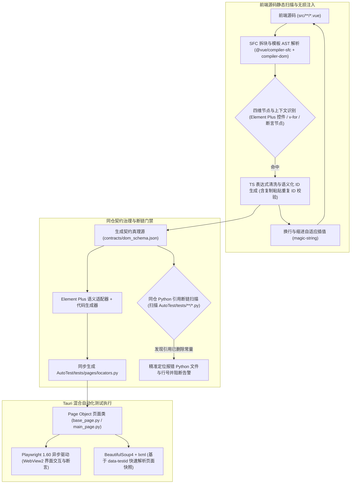
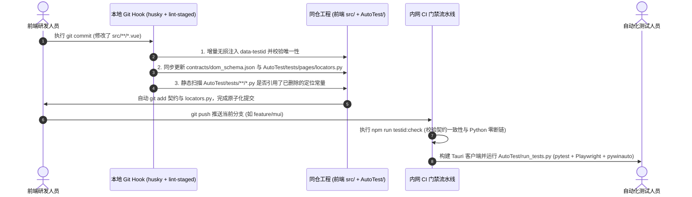

# 前端 DOM 节点自动化提取与自动化测试契约同步方案设计说明书（v2.0）

---

## 1. 方案背景与核心痛点

### 1.1 项目现状与痛点
当前项目基于 **Tauri 桌面端架构**，前端视图层采用 **Vue 3 + TypeScript + Element Plus** 构建，同仓下的 `AutoTest/` 目录承载了基于 **`pytest 8.0`（异步模式）+ `Playwright 1.60`（WebView2 界面层）+ `pywinauto 0.6.8`（Windows 原生窗口/菜单层）** 的混合端到端自动化测试框架（标准 Page Object 模式）。

在日常敏捷迭代（如 UI 改版、组件重构、交互调整）中，WebView 界面层的自动化测试面临以下突出痛点：
- **脆弱的选择器导致用例频繁失效**：`AutoTest/tests/pages/` 中的页面对象若依赖 CSS 类名（如 `.el-button--primary`）、文本选择器或层级 XPath，一旦前端调整布局嵌套或样式，测试运行即批量抛出超时失败并触发 `screenshots/fail_*.png` 告警；
- **Element Plus 深层封装导致交互报错**：Element Plus 组件普遍采用外层 `<div>` 包裹内层真实控件（如 `<el-input>` 内部嵌套 `<input class="el-input__inner">`）以及 `Teleport` 浮层挂载 `<body>` 机制。若直接定位组件外层容器执行 Playwright `locator.fill()`，会直接抛出 `Element is not an <input>, <textarea> or [contenteditable] element` 异常；
- **桌面端高频复杂组件定位困难**：桌面应用包含大量工具栏纯图标按钮（无文本，仅带 `<el-tooltip>`）、工程目录树（`<el-tree>`）、多工作区页签（`<el-tabs>`）及动态列表（`v-for`），手工抓取定位符耗时极长；
- **前后端同仓但缺乏静态契约联动**：尽管前端源码与 `AutoTest/` 位于同一仓库内，但前端删改交互节点时无法自动检查 `AutoTest/tests/` 下哪些 Python 用例引用了该节点，只能在跑批超时（单用例最高 300s）后被动排查。

### 1.2 架构边界与建设目标
- **职责边界划分**：
  - **Windows 原生控件层**（顶层系统菜单栏、系统原生文件对话框、窗口句柄控制，如 `test_*_menu.py`）：继续由 **`pywinauto`** 负责，不在本方案扫描范围内；
  - **Tauri WebView2 视图层**（所有 Vue 3 + Element Plus 渲染的业务界面、弹窗、工作区面板及 `BeautifulSoup4` 页面内容解析）：由本方案实现 **100% 自动化定位契约覆盖**。
- **核心建设目标**：
  1. **全域节点自动提取**：自动识别 Vue 3 + TS 组件中的交互节点、Element Plus 特有事件控件、桌面端图标按钮与关键断言节点，支持 `v-for` 动态行上下文感知；
  2. **源码级无损微创注入**：基于 Vue 3 官方编译器偏移量与 `magic-string` 原位插值注入 `data-testid`，兼容 Windows `CRLF` / `LF` 换行符与 ESLint 规范，**零代码格式化污染**；
  3. **同仓原子级同步与静态断链检查**：充分利用前端与 `AutoTest/` 同仓（Monorepo）优势，一次提交同步更新 `AutoTest/tests/pages/locators.py`，并**直接静态扫描 Python 用例中的失效常量引用**；
  4. **内网纯净落地**：100% 选用纯 JavaScript 开发依赖（零 C++/Rust 原生编译与外网二进制下载），无缝兼容内网 npm 镜像源与 Tauri 构建链路。

---

## 2. 总体技术架构设计

方案采用 **“Vue SFC 精确解析 + 微创原位插值 + Element Plus 语义穿透 + 同仓 Page Object 契约直生”** 架构：



---

## 3. 详细技术实现方案

### 3.1 核心依赖选型与内网环境适配
所有工具包均仅安装于前端 `devDependencies`，**100% 纯 JS 实现（无 `node-gyp` 编译、无 GitHub Releases 二进制外链拉取）**，内网 npm 私服可直接高速安装，且绝不打入前端运行时产物：

| 依赖包 | 版本规范 | 选型定位与内网/Vue 3 适配考量 |
| :--- | :--- | :--- |
| **`@vue/compiler-sfc`** | `^3.4.0`（复用工程现有 Vue 版本） | Vue 3 官方内置编译器（无需额外引入异构解析器）。先精确拆离 `<template>` 与 `<script setup lang="ts">`，获取 `<template>` 起始偏移量，**彻底避免 TS 泛型尖括号（如 `ref<Array<ProjectItem>>()`）干扰 HTML 解析**。 |
| **`@vue/compiler-dom`** | `^3.4.0`（复用工程现有 Vue 版本） | 将 `<template>` 编译为携带精确行列号与字符偏移量（`loc.start.offset`）的 AST，精准捕获 Element Plus 组件指令、具名插槽与属性。 |
| **`magic-string`** | `^0.30.0` | Vite 底层核心源码微创编辑库。直接按字符索引原位插入 `data-testid`，保留文件原有的 `CRLF`（Windows）或 `LF` 换行符、缩进与注释，确保 Git Diff 极度干净。 |
| **`fast-glob`** | `^3.3.0` | 工业级纯 JS 高性能文件扫描器，内置跨平台路径处理，配合路径归一化逻辑消除 Windows 反斜杠 `\` 差异。 |

---

### 3.2 节点识别规则体系（针对桌面端 + Element Plus 深度定制）

AST 访问器（Visitor）遍历 `<template>` 节点时维护**祖先节点栈（Ancestor Stack）**，按四个维度精准捕获节点：

1. **点击、菜单与桌面工具栏触发类**：
   - 绑定点击/双击/右键事件：`@click`、`@dblclick`、`@contextmenu`、`v-on:click`；
   - 原生与导航标签：`<button>`、`<a>`、`<router-link>`；
   - **Element Plus 特有触发组件**：
     - 下拉菜单项：`<el-dropdown>`（`@command`）及其子项 `<el-dropdown-item>`；
     - 确认气泡与对话框动作：`<el-popconfirm>`（`@confirm` / `@cancel`）；
     - 工作区页签与树节点：`<el-tabs>` / `<el-tab-pane>`、`<el-tree>`（`@node-click` / `@check`）；
     - 桌面工具栏纯图标按钮：识别包裹在 `<el-tooltip content="...">` 内的 `<el-button>` 或 SVG 图标触发容器。
2. **输入与 Element Plus 表单控制类**：
   - 双向绑定指令：`v-model` 及 Vue 3 具名绑定（如 `v-model:model-value`，智能排除 `<el-dialog v-model="visible">` 等显隐控制属性将其归为容器）；
   - 输入变更事件：`@input`、`@change`、`@current-change`、`<input>`、`<textarea>`；
   - **Element Plus 表单控件全集**：`<el-input>`、`<el-input-number>`、`<el-select>`、`<el-option>`、`<el-tree-select>`、`<el-cascader>`、`<el-date-picker>`、`<el-switch>`、`<el-checkbox>`、`<el-radio-group>` / `<el-radio>`、`<el-slider>`、`<el-upload>`。
3. **窗口容器与断言展示类（赋能 Playwright `expect` 与 `BeautifulSoup4` 解析）**：
   - 模态容器：`<el-dialog>`、`<el-drawer>`、`<el-table>`（归类为 `container` / `modal`）；
   - **轻量断言标记自动升级**：针对无交互事件但测试需校验文本的状态栏、运行日志、计算结果节点，支持开发或测试添加极简空属性 `data-test`（如 `<span data-test>{{ projectStatus }}</span>`），脚本自动将其补全升级为标准 `data-testid="main__text_projectstatus"`。
4. **动态循环与树/表行上下文感知（`v-for` & Scoped Slot）**：
   - 当祖先栈包含 `v-for`（如项目列表、菜单列表）或 `<el-table-column>` / `<el-tree>` 的 `#default="{ node, data, $index }"` 作用域插槽时，自动标记 `dynamic: true`，优先提取业务唯一键（如 `item.id` / `node.key`）或循环索引（`index` / `$index`）。

---

### 3.3 语义化命名规范与 TS 表达式清洗（TestID Specification）

#### 3.3.1 命名结构规范
针对 Windows 开发环境，所有文件路径先统一归一化为 POSIX 斜杠 `/`，再派生语义标识：

```text
# 静态元素格式
data-testid="{scope_name}__{element_type}_{semantic_key}[_{dedup_index}]"

# 动态列表/树节点元素格式（Vue 动态模板绑定）
:data-testid="`{scope_name}__{element_type}_{semantic_key}__${index}`"
```

- **`scope_name`（页面/模块前缀）**：
  - 页面视图（如 `src/views/project/MainWorkspace.vue`）→ `project_mainworkspace`（与 `AutoTest/tests/pages/` 下的 Page Object 类一一对应）；
  - 公共子组件（如 `src/components/ParamPanel.vue`）→ `comp_parampanel`。
- **`element_type`（控件意图分类）**：
  - `btn`（按钮/图标动作）、`input`（文本/数值输入）、`select`（下拉/树选择/日期）、`toggle`（开关/单复选）、`tree`（树控件）、`tab`（工作区页签）、`modal`（弹窗抽屉）、`text`（状态/结果断言）。
- **`semantic_key`（多级清洗与桌面端图标按钮兜底）**：
  1. **一级提取（TS 表达式清洗）**：剥离修饰符、TS 类型断言与调用括号。如 `@click.stop="runProject(currentId as string)"` → `runproject`；`@click="() => openSettingDialog('env')"` → `opensettingdialog_env`；`v-model.trim="configForm.projectPath"` → `configform_projectpath`；状态赋值 `@click="panelCollapsed = !panelCollapsed"` → `toggle_panelcollapsed`。
  2. **二级提取（组件业务属性与 Tooltip 兜底）**：针对桌面端常见的无文本纯图标按钮或通用事件，依次提取 `<el-form-item prop="...">`、`<el-tab-pane name="...">`、`<el-dropdown-item command="...">` 或外层 `<el-tooltip content="...">` 语义摘要。
  3. **三级兜底**：回退为 `{tag}_{seq}` 并在构建报告中标注位置。

#### 3.3.2 同页多实例复用子组件隔离
当同一工作区页面挂载多个相同子组件（如左右分栏同时渲染两个 `<ParamPanel />`）时：
- 父级挂载点声明作用域 `<ParamPanel data-test-scope="left_panel" />`；
- 对于 Vue 3 多根节点（Fragment）子组件，规范要求业务主容器显式绑定 `v-bind="$attrs"`，确保透传属性不丢失；
- Python `BasePage` 与 `locators.py` 提供 `within_scope("left_panel", CompParampanelLocators.INPUT_VALUE)` 组合定位。

---

### 3.4 Element Plus 组件语义适配层（Playwright 专属适配）

> [!IMPORTANT]
> 在 Playwright 1.60 中，对 `<el-input data-testid="xxx">` 直接调用 `page.get_by_test_id("xxx").fill("val")` 会因命中外层包裹 `<div>` 而直接报错失败！同时 Element Plus 的下拉框、弹窗默认通过 `Teleport` 渲染至 `<body>` 根节点。本方案通过 **Element Plus 语义适配器** 在生成 `locators.py` 时自动完成选择器穿透。

| Element Plus 组件标签 | 真实 DOM 渲染结构特征 | 生成器输出的 Playwright 定位策略 | 解决的自动化测试痛点 |
| :--- | :--- | :--- | :--- |
| `<el-button>` / 原生标签 | `data-testid` 直接位于 `<button>` 根节点 | `[data-testid='...']` | 直接支持 `await page.locator(...).click()` |
| `<el-input>` | 外层 `<div class="el-input">` 包裹内部 `<input>` 或 `<textarea>` | `[data-testid='...'] input, [data-testid='...'] textarea` | **自动穿透外层 Wrapper**，`await page.locator(...).fill("...")` 直接成功 |
| `<el-input-number>` | 外层 `<div>` 包含加减号 `<span>` 与内部 `<input>` | `[data-testid='...'] input` | 精准命中数值输入框，支持直接 `fill()` 与断言当前数值 |
| `<el-checkbox>` / `<el-switch>` | 外层 `<label>` 或 `<div>` 包含视觉点击区与隐藏 `<input>` | 交互点击：`[data-testid='...']`<br/>状态断言：`[data-testid='...'].is-checked` | 兼容 Playwright 点击切换与勾选状态 `expect(...).to_have_class(...)` 校验 |
| `<el-upload>` | 触发区内部包含隐藏 `<input class="el-upload__input" type="file">` | `[data-testid='...'] input[type='file']` | 免除调用 `pywinauto` 操作原生文件选择框，直接用 Playwright `set_input_files()` 极速上传（注：若走 Tauri 原生 `dialog.open` 则交由 `pywinauto` 处理） |
| `<el-select>` / `<el-dropdown>` | 触发器在原位，下拉菜单 `Teleport` 挂载至 `<body>` 底部 | 触发器：`[data-testid='...']`<br/>浮层：自动补充 `:teleported="false"` 或注入专属 `popper-class="tid-popper__{id}"` | 彻底解决同屏多个下拉框时，`<body>` 下存在多个 `.el-select-dropdown` 导致选错选项的问题 |
| `<el-tree>` | 树容器包裹动态渲染的 `.el-tree-node` | 容器：`[data-testid='...']`<br/>辅助方法按节点文本/Key 过滤子级 `.el-tree-node__content` | 适配桌面软件左侧工程项目树点击、展开与右键菜单触发 |

---

### 3.5 契约真理源（`contracts/dom_schema.json`）结构规范

契约文件随前端源码同仓存放于 `contracts/dom_schema.json`，完整记录定位符、原始组件标签、UI 提示文案与行号坐标：

```json
{
  "schemaVersion": "2.0",
  "framework": "vue3-element-plus",
  "pages": {
    "main_workspace": {
      "sourceFile": "src/views/MainWorkspace.vue",
      "elements": {
        "input_project_name": {
          "testid": "main_workspace__input_project_name",
          "tag": "el-input",
          "type": "input",
          "dynamic": false,
          "selector": "[data-testid='main_workspace__input_project_name'] input",
          "label": "请输入项目名称",
          "line": 22
        },
        "btn_runproject": {
          "testid": "main_workspace__btn_runproject",
          "tag": "el-button",
          "type": "btn",
          "dynamic": false,
          "selector": "[data-testid='main_workspace__btn_runproject']",
          "label": "运行项目 (Tooltip)",
          "line": 35
        },
        "btn_selectitem": {
          "testid": "main_workspace__btn_selectitem",
          "tag": "div",
          "type": "btn",
          "dynamic": true,
          "dynamicVar": "index",
          "selectorTemplate": "[data-testid='main_workspace__btn_selectitem__{index}']",
          "label": "工程列表项",
          "line": 58
        },
        "text_run_status": {
          "testid": "main_workspace__text_run_status",
          "tag": "span",
          "type": "text",
          "dynamic": false,
          "selector": "[data-testid='main_workspace__text_run_status']",
          "label": "底部状态栏运行状态",
          "line": 84
        }
      }
    }
  }
}
```

---

### 3.6 Python `AutoTest/` 代码生成模型（适配异步 Playwright + Page Object + BS4）

脚本直接将生成的定位器输出至同仓目录 **`AutoTest/tests/pages/locators.py`**，无缝对接现有的 `tests/pages/base_page.py`、`main_page.py` 以及 `BeautifulSoup4` 解析场景：

```python
"""
======================================================================
此文件由前端 DOM 契约工具自动扫描生成，禁止手动编辑！
前端技术栈: Vue 3 + TS + Element Plus | 测试驱动: Playwright 1.60 (Async)
======================================================================
"""


class MainWorkspaceLocators:
    """页面契约: src/views/MainWorkspace.vue"""

    # [input] 请输入项目名称 (el-input 自动穿透内部 input) | Line: 22
    INPUT_PROJECT_NAME = "[data-testid='main_workspace__input_project_name'] input"
    INPUT_PROJECT_NAME_TID = "main_workspace__input_project_name"

    # [btn] 运行项目 (Tooltip) (el-button) | Line: 35
    BTN_RUNPROJECT = "[data-testid='main_workspace__btn_runproject']"
    BTN_RUNPROJECT_TID = "main_workspace__btn_runproject"

    # [text] 底部状态栏运行状态 (span) | Line: 84
    TEXT_RUN_STATUS = "[data-testid='main_workspace__text_run_status']"
    TEXT_RUN_STATUS_TID = "main_workspace__text_run_status"

    @staticmethod
    def btn_selectitem(index: int | str = 0) -> str:
        """[动态列表项 btn] 工程列表项 | Line: 58"""
        return f"[data-testid='main_workspace__btn_selectitem__{index}']"

    @staticmethod
    def within_scope(scope: str, child_selector: str) -> str:
        """组合定位同页多实例复用子组件"""
        return f"[data-test-scope='{scope}'] {child_selector}"
```

> [!TIP]
> 每个元素同时生成带穿透的 CSS 选择器（如 `BTN_RUNPROJECT`，供 Playwright `page.locator()` 直接交互）与纯 ID 常量（`_TID` 后缀，供 `BeautifulSoup4` 执行 `soup.find(attrs={"data-testid": MainWorkspaceLocators.TEXT_RUN_STATUS_TID})` 高速解析页面快照时直接复用）。

在 `AutoTest/tests/pages/main_page.py`（基于 `pytest-asyncio` 与 `BasePage`）中的实际使用方式：

```python
from playwright.async_api import expect
from tests.pages.base_page import BasePage
from tests.pages.locators import MainWorkspaceLocators as Loc


class MainPage(BasePage):
    async def create_and_run_project(self, project_name: str) -> None:
        # 1. Element Plus 输入框直接 fill（已自动穿透至内部 input）
        await self.page.locator(Loc.INPUT_PROJECT_NAME).fill(project_name)

        # 2. 点击动态列表第 0 个工程项与工具栏运行按钮
        await self.page.locator(Loc.btn_selectitem(0)).click()
        await self.page.locator(Loc.BTN_RUNPROJECT).click()

        # 3. 异步等待断言底部运行状态，无需硬编码 sleep，规避 300s 超时干等
        await expect(self.page.locator(Loc.TEXT_RUN_STATUS)).to_have_text("运行完成")
```

---

## 4. 源码无损注入对比与 Windows / ESLint 兼容设计

> [!NOTE]
> **向技术评审人员重点强调**：针对团队 Windows 开发环境与 ESLint 规范，注入器内置了 **“行尾符保持（CRLF/LF Preservation）+ 首属性缩进嗅探”** 机制——单行标签采用空格内联插入，多行折行标签自动嗅探并对齐下一行属性的缩进空格，绝不触发 `eslint-plugin-vue` 格式报错或整文件换行符变更。

```html
<!-- ==================== 扫描注入前 (.vue 源码) ==================== -->
<template>
  <div class="workspace-toolbar">
    <!-- 多行排版的 Element Plus 输入框 -->
    <el-input
      v-model.trim="projectName"
      placeholder="请输入项目名称"
    />
    <!-- 桌面端常见的纯图标按钮，通过 Tooltip 提取语义注释 -->
    <el-tooltip content="运行项目">
      <el-button :icon="VideoPlay" @click="runProject(currentId)" />
    </el-tooltip>

    <!-- v-for 动态工程列表 -->
    <div
      v-for="(item, index) in projectList"
      :key="item.id"
      class="project-row"
      @click="selectItem(item)"
    >
      {{ item.name }}
    </div>

    <!-- 状态栏断言节点 (开发或测试仅需写 data-test 空属性) -->
    <span class="status-bar" data-test>{{ runStatus }}</span>
  </div>
</template>

<!-- ==================== 脚本无损执行后 ==================== -->
<template>
  <div class="workspace-toolbar">
    <!-- 自动对齐原有换行与缩进，原有注释、空行及 CRLF 100% 保持原样 -->
    <el-input
      data-testid="main_workspace__input_projectname"
      v-model.trim="projectName"
      placeholder="请输入项目名称"
    />
    <!-- 纯图标按钮自动注入标准定位符 -->
    <el-tooltip content="运行项目">
      <el-button data-testid="main_workspace__btn_runproject" :icon="VideoPlay" @click="runProject(currentId)" />
    </el-tooltip>

    <!-- v-for 循环体自动注入动态索引绑定 -->
    <div
      :data-testid="`main_workspace__btn_selectitem__${index}`"
      v-for="(item, index) in projectList"
      :key="item.id"
      class="project-row"
      @click="selectItem(item)"
    >
      {{ item.name }}
    </div>

    <!-- data-test 自动补全升级为标准语义化 data-testid -->
    <span class="status-bar" data-testid="main_workspace__text_runstatus">{{ runStatus }}</span>
  </div>
</template>
```

---

## 5. Tauri 构建安全与同仓契约防呆机制

### 5.1 Tauri 桌面包构建策略（严防测试包误剥离）
> [!WARNING]
> **Tauri 桌面应用特殊注意事项**：不同于普通 Web 应用直连开发服务器，Tauri 端到端自动化测试通常针对打包构建出的桌面客户端程序连接 WebView2 进行测试。若在常规 `vite build` 中默认剥离 `data-testid`，会导致构建出的客户端包丢失全部测试锚点！

因此制定以下安全策略：
1. **默认保留锚点（推荐）**：Tauri 前端静态资源封装于本地客户端二进制包内，无需经过公网带宽传输，保留 `data-testid` 对桌面端启动耗时与内存占用**零影响**，同时支持对预发布安装包直接运行 `AutoTest/run_tests.py` 冒烟测试；
2. **正式对外发行包按需剥离（可选）**：仅当配置显式环境变量 `VITE_STRIP_TESTID=true`（用于最终客户交付 Release 签名包）时，通过 `vite.config.ts` 中 `@vitejs/plugin-vue` 的 `template.compilerOptions.nodeTransforms` 在编译期静态移除 `data-testid` 属性。

### 5.2 幂等性与“复制粘贴重复 ID”自愈校验
- **人工配置优先**：节点若已存在唯一合法的 `data-testid`，扫描器直接收录至契约表，绝不覆盖；
- **复制粘贴防重（Duplicate Check）**：前端研发复制已有 `<el-button data-testid="...__btn_save" @click="onSave">` 改写为“另存为”按钮 `@click="onSaveAs"` 时，扫描器建立全局唯一性哈希表，检测到重复 ID 且绑定方法已变更为 `onSaveAs` 时，**自动为新节点重写分配 `...__btn_saveas`**；若绑定完全相同无法自动消歧，则在控制台抛出精确的文件路径与行号阻断提交。

### 5.3 同仓优势放大：Python 用例静态断链扫描（Dead Locator Reference Check）
得益于前端代码与 `AutoTest/` 处于同一仓库目录（如 `C:\project\ProximaUI\feature\mui\`），本方案实现了跨语言静态引用保护：
- 当某次前端重构删除了某个旧按钮导致 `MainWorkspaceLocators.BTN_OLD_ACTION` 从 `locators.py` 中移除时；
- Node.js 校验脚本直接在毫秒级内扫描同仓 `AutoTest/tests/**/*.py` 全量代码；
- 一旦发现如 `AutoTest/tests/pages/main_page.py:63` 仍在引用 `BTN_OLD_ACTION`，**当场输出精准的断链告警（指出具体 `.py` 文件与行号）**，彻底消灭运行期 `AttributeError` 或 300s 超时等待！

### 5.4 `--dry-run` 预览模式
支持执行 `npm run testid:dry-run`，仅在终端打印拟注入的 `.vue` 文件变更预览、`locators.py` 增量统计及断链检查报告，不落盘修改任何文件，确保存量工程首次全量接入安全可控。

---

## 6. 同仓全自动化工作流集成路线

由于前端工程与 `AutoTest/` 同仓共治，无需复杂的跨仓库推送机器人，**分支天然 100% 同步对齐**（例如在 `feature/mui` 分支开发时，前端组件与 `AutoTest/tests/pages/locators.py` 在同一次 Commit 中原子更新）：



### 配套提效工具：开发/测试模式快捷键拾取浮层（Dev Inspector）
在开发环境（`import.meta.env.DEV`）挂载一段不足 50 行的纯原生辅助脚本：研发或测试人员在运行中的 Tauri 窗口内按住 `Alt` 键悬停鼠标于任意按钮或输入框上，界面即刻浮层显示对应的 Python 常量名（如 `MainWorkspaceLocators.BTN_RUNPROJECT`），**单击即可复制常量路径**，直接在 `AutoTest/tests/pages/` 中粘贴编写用例，无需开启 WebView2 开发者工具逐层查找 DOM。

---

## 7. 方案综合收益对比

| 评估维度 | 传统手工抓取定位维护 | 本方案（同仓 AST 契约生成 + Element Plus 穿透架构） |
| :--- | :--- | :--- |
| **定位健壮性** | 强依赖 Element Plus 内部样式类与层级，改版即挂 | 专有 `[data-testid]` 契约绑定，UI 重构与改版 **0 破坏** |
| **Element Plus 兼容性** | 手工编写 `.el-input__inner` 等脆弱内部类名 | **生成器自动穿透 Wrapper 与关联浮层**，Playwright `fill()` 直接可用 |
| **测试驱动契合度** | 需手工维护多套选择器 | 同时输出 Playwright 穿透选择器与 `BeautifulSoup4` 纯属性 ID 常量 |
| **变更协同效率** | 前端删改按钮无感知，跑测试超时截图后才人工排查 | **同仓毫秒级扫描 `AutoTest/tests/**/*.py` 断链引用**，提交阶段提前精准预警 |
| **多分支管理成本** | 特性分支与主干用例容易错位冲突 | 同仓同 Commit 原子提交，`feature/mui` 与主干分支天然对齐 |
| **内网与研发体验** | 前端手写繁琐，测试反复开 DevTools 查节点 | 纯 JS 依赖内网 `npm i` 即用；前端无感注入，测试 `Alt+点击` 一键复制常量 |

---

## 8. 第三方技术评审关注项（FAQ）

- **Q1：内网开发环境无法访问 GitHub 等外网资源，工具链安装会有阻碍吗？**
  - **不会**。核心解析器 `@vue/compiler-sfc` 与 `@vue/compiler-dom` 本身就是现有 Vue 3 工程已安装的官方核心包；新增的 `magic-string` 与 `fast-glob` 均为零原生编译的纯 JavaScript 标准 npm 包，内网镜像源 100% 原生支持，无任何二进制外链下载步骤。

- **Q2：Windows 开发环境下，脚本修改 `.vue` 源码是否会引发 `CRLF/LF` 换行符污染或破坏 ESLint / Volar 类型检查？**
  - **不会**。脚本在读取文件时自动检测并沿用原文件的行尾符（`\r\n` 或 `\n`），并通过 `magic-string` 仅在开始标签内部做原位字符插入，完全不触碰 `<script setup lang="ts">` 与 `<style>` 区块，且自适应多行属性缩进，兼容 ESLint、Prettier 与 `vue-tsc`。

- **Q3：Tauri 应用中既有原生菜单（`pywinauto`），又有多个 WebView 窗口与动态列表（`Playwright`），如何协同？**
  - **职责正交且无缝配合**。原生系统菜单与系统级弹窗继续走 `pywinauto`（`test_*_menu.py`）；进入 Tauri WebView 后，各窗口视图组件按文件模块生成独立的 `XxxLocators` 类（对应 `tests/pages/` 下的各 Page Object）；列表与树控件通过动态绑定 `` :data-testid="`...__${index}`" `` 及 Python 参数化静态方法精准定位任意行。

- **Q4：研发日常复制粘贴已有按钮代码，会不会导致两个按钮拥有相同的 `data-testid`？**
  - **已内置防重自愈门禁**。扫描脚本维护全局 `testid` 注册表，当检测到同一组件出现重复 ID（典型复制粘贴场景）且新节点绑定的 `@click` / `v-model` 已改变时，会自动为复制出的新节点重新生成语义 ID；若事件也完全相同，则在本地 Hook 报错提示具体行号，杜绝脏数据入库。

---

## 9. 核心工程脚本完整代码实现（已实测验证，可直接拷入项目落地）

以下脚本均已针对 `ProximaUI` 目录结构（前端 `src/` + 同仓 `AutoTest/tests/pages/`）完成实测验证，可直接复制放入工程对应目录运行。

### 9.1 `package.json` 命令与 `lint-staged` 门禁配置

在内网终端安装两个轻量级纯 JS 辅助依赖（复用工程已有的 `@vue/compiler-sfc` 与 `@vue/compiler-dom`）：

```bash
npm install -D magic-string fast-glob
```

在项目根目录 `package.json` 中补充如下配置：

```json
{
  "scripts": {
    "testid:sync": "node scripts/dom-contract-sync.mjs",
    "testid:dry-run": "node scripts/dom-contract-sync.mjs --dry-run",
    "testid:check": "node scripts/dom-contract-sync.mjs --check"
  },
  "lint-staged": {
    "src/**/*.vue": [
      "node scripts/dom-contract-sync.mjs",
      "git add contracts/dom_schema.json AutoTest/tests/pages/locators.py"
    ]
  }
}
```

---

### 9.2 核心 AST 扫描注入、Python 生成与断链检查脚本（`scripts/dom-contract-sync.mjs`）

在工程根目录新建 `scripts/dom-contract-sync.mjs`：

```javascript
#!/usr/bin/env node
/**
 * ProximaUI - Vue 3 + TS + Element Plus DOM 契约自动提取与 AutoTest 同步引擎
 * 用法：
 *   node scripts/dom-contract-sync.mjs             # 扫描注入源码 + 生成契约与 locators.py + 断链检查
 *   node scripts/dom-contract-sync.mjs --dry-run   # 仅预览变更与统计报告，不写盘
 *   node scripts/dom-contract-sync.mjs --check     # CI 门禁校验模式（不一致或存在断链则退出码为 1）
 */

import fs from 'node:fs';
import path from 'node:path';
import process from 'node:process';
import { parse as parseSfc } from '@vue/compiler-sfc';
import { parse as parseDom, NodeTypes } from '@vue/compiler-dom';
import MagicString from 'magic-string';
import fg from 'fast-glob';

const args = process.argv.slice(2);
const isDryRun = args.includes('--dry-run');
const isCheckMode = args.includes('--check');

function getArgValue(flag, defaultVal) {
  const idx = args.indexOf(flag);
  return idx !== -1 && args[idx + 1] ? args[idx + 1] : defaultVal;
}

const ROOT_DIR = process.cwd();
const SRC_DIR = getArgValue('--src', 'src');
const SCHEMA_REL_PATH = getArgValue('--schema', 'contracts/dom_schema.json');
const PYTHON_OUT_REL_PATH = getArgValue('--python-out', 'AutoTest/tests/pages/locators.py');
const AUTOTEST_TESTS_DIR = getArgValue('--autotest-dir', 'AutoTest/tests');

const ACTION_EVENTS = new Set([
  'click', 'dblclick', 'contextmenu', 'confirm', 'cancel',
  'command', 'tab-click', 'node-click', 'current-change', 'size-change',
]);
const INPUT_EVENTS = new Set(['input', 'change']);

const MODAL_TAGS = new Set(['el-dialog', 'el-drawer']);
const TREE_TAGS = new Set(['el-tree']);
const TAB_TAGS = new Set(['el-tab-pane']);
const UPLOAD_TAGS = new Set(['el-upload']);
const TOGGLE_TAGS = new Set(['el-switch', 'el-checkbox', 'el-radio']);
const SELECT_TAGS = new Set([
  'select', 'el-select', 'el-tree-select', 'el-cascader', 'el-date-picker', 'el-time-picker',
]);
const INPUT_TAGS = new Set(['input', 'textarea', 'el-input', 'el-input-number', 'el-autocomplete']);
const BUTTON_TAGS = new Set(['button', 'el-button', 'el-dropdown-item', 'el-popconfirm']);
const NAV_TAGS = new Set(['a', 'router-link']);

function toPosixPath(p) {
  return p.replace(/\\/g, '/');
}

function deriveScopeInfo(relFilePath) {
  const posix = toPosixPath(relFilePath);
  const withoutSrc = posix.replace(/^src\//, '').replace(/\.vue$/i, '');
  const parts = withoutSrc.split('/').filter(Boolean);

  let normalizedParts = parts;
  if (parts[0] === 'views' || parts[0] === 'pages') {
    normalizedParts = parts.slice(1);
  } else if (parts[0] === 'components') {
    normalizedParts = ['comp', ...parts.slice(1)];
  }
  if (normalizedParts.length > 1 && normalizedParts[normalizedParts.length - 1].toLowerCase() === 'index') {
    normalizedParts.pop();
  }

  const slugParts = normalizedParts.map((seg) =>
    seg
      .replace(/([a-z0-9])([A-Z])/g, '$1_$2')
      .replace(/[^a-zA-Z0-9]+/g, '_')
      .replace(/^_+|_+$/g, '')
      .toLowerCase()
  );

  const scopeName = slugParts.join('_') || 'page';
  const className =
    scopeName
      .split('_')
      .filter(Boolean)
      .map((s) => s.charAt(0).toUpperCase() + s.slice(1))
      .join('') + 'Locators';

  return { scopeName, className };
}

function sanitizeIdentifier(str) {
  if (!str) return '';
  return str
    .replace(/^\$+/, '')
    .replace(/([a-z0-9])([A-Z])/g, '$1_$2')
    .replace(/[^a-zA-Z0-9]+/g, '_')
    .replace(/^_+|_+$/g, '')
    .toLowerCase()
    .slice(0, 32)
    .replace(/_+$/g, '');
}

function cleanExpression(rawExpr) {
  if (!rawExpr || typeof rawExpr !== 'string') return '';
  let expr = rawExpr.trim();
  expr = expr.replace(/\s+as\s+[A-Za-z0-9_<>[\]|&\s]+/g, '');
  expr = expr.replace(/^\([^)]*\)\s*=>\s*/, '').replace(/^[a-zA-Z_$][\w$]*\s*=>\s*/, '');

  const toggleMatch = expr.match(/^([a-zA-Z_$][\w$.]*)\s*=\s*!\s*\1$/);
  if (toggleMatch) return 'toggle_' + sanitizeIdentifier(toggleMatch[1]);

  const assignMatch = expr.match(/^([a-zA-Z_$][\w$.]*)\s*=\s*(.+)$/);
  if (assignMatch && !expr.includes('==')) return 'set_' + sanitizeIdentifier(assignMatch[1]);

  const callMatch = expr.match(/^([a-zA-Z_$][\w$.]*)\s*\(([^)]*)\)/);
  if (callMatch) {
    const fnName = callMatch[1].replace(/^\$?(?:router|emit)\./, '');
    const firstArg = callMatch[2].split(',')[0]?.trim() || '';
    const strLiteral = firstArg.match(/^['"]([a-zA-Z0-9_/-]{1,16})['"]$/);
    return sanitizeIdentifier(strLiteral ? `${fnName}_${strLiteral[1]}` : fnName);
  }
  return sanitizeIdentifier(expr);
}

function extractElementInnerText(node) {
  if (!node.children || node.children.length === 0) return '';
  const chunks = [];
  for (const child of node.children) {
    if (child.type === NodeTypes.TEXT) {
      const t = child.content.trim();
      if (t) chunks.push(t);
    } else if (child.type === NodeTypes.INTERPOLATION && child.content?.content) {
      chunks.push(`{{ ${child.content.content.trim()} }}`);
    }
  }
  return chunks.join(' ').replace(/\s+/g, ' ').trim().slice(0, 40);
}

function extractDynamicScopeVar(node) {
  if (!node.props) return null;
  for (const prop of node.props) {
    if (prop.type !== NodeTypes.DIRECTIVE) continue;

    if (prop.name === 'for' && prop.exp?.content) {
      const forContent = prop.exp.content.trim();
      const tupleMatch = forContent.match(
        /^\(\s*([a-zA-Z_$][\w$]*)\s*,\s*([a-zA-Z_$][\w$]*)(?:\s*,\s*([a-zA-Z_$][\w$]*))?\s*\)\s+(?:in|of)\b/
      );
      if (tupleMatch) return { isDynamic: true, dynamicVar: tupleMatch[3] || tupleMatch[2] };

      const keyProp = node.props.find(
        (p) => p.type === NodeTypes.DIRECTIVE && p.name === 'bind' && p.arg?.content === 'key'
      );
      if (keyProp?.exp?.content && /^[a-zA-Z_$][\w$.]*$/.test(keyProp.exp.content.trim())) {
        return { isDynamic: true, dynamicVar: keyProp.exp.content.trim() };
      }
      return { isDynamic: true, dynamicVar: null };
    }

    if (prop.name === 'slot' && prop.exp?.content) {
      const slotExp = prop.exp.content.trim();
      if (/^\{[^}]*(?:^|[^\w$])\$index(?![\w$])[^}]*\}$/.test(slotExp)) {
        return { isDynamic: true, dynamicVar: '$index' };
      }
      if (/^\{[^}]*(?:^|[^\w$])index(?![\w$])[^}]*\}$/.test(slotExp)) {
        return { isDynamic: true, dynamicVar: 'index' };
      }
      if (/^[a-zA-Z_$][\w$]*$/.test(slotExp)) {
        return { isDynamic: true, dynamicVar: `${slotExp}.$index` };
      }
    }
  }
  return null;
}

function buildPlaywrightSelector(tag, testId, staticAttrs, isDynamic, dynamicPlaceholder = '{index}') {
  const targetId = isDynamic ? `${testId}__${dynamicPlaceholder}` : testId;
  const base = `[data-testid='${targetId}']`;
  if (tag === 'el-input') {
    const innerTag = staticAttrs.get('type') === 'textarea' ? 'textarea' : 'input';
    return `${base} ${innerTag}`;
  }
  if (tag === 'el-input-number' || tag === 'el-autocomplete') return `${base} input`;
  if (tag === 'el-upload') return `${base} input[type='file']`;
  return base;
}

function classifyElementNode(node, ancestorContext) {
  const tag = node.tag;
  if (tag === 'template' || tag === 'slot' || tag === 'transition' || tag === 'keep-alive') return null;

  const staticAttrs = new Map();
  let existingStaticTestIdProp = null;
  let existingDynamicTestIdProp = null;
  let dataTestPlaceholderProp = null;
  let modelDirective = null;
  const actionDirectives = [];
  const inputDirectives = [];

  for (const prop of node.props || []) {
    if (prop.type === NodeTypes.ATTRIBUTE) {
      staticAttrs.set(prop.name, prop.value?.content ?? '');
      if (prop.name === 'data-testid') existingStaticTestIdProp = prop;
      else if (prop.name === 'data-test' && !prop.value) dataTestPlaceholderProp = prop;
    } else if (prop.type === NodeTypes.DIRECTIVE) {
      if (prop.name === 'bind' && prop.arg?.content === 'data-testid') existingDynamicTestIdProp = prop;
      else if (prop.name === 'model') modelDirective = prop;
      else if (prop.name === 'on' && prop.arg?.content) {
        if (ACTION_EVENTS.has(prop.arg.content)) actionDirectives.push(prop);
        if (INPUT_EVENTS.has(prop.arg.content)) inputDirectives.push(prop);
      }
    }
  }

  let elementType = null;
  if (dataTestPlaceholderProp) elementType = 'text';
  else if (MODAL_TAGS.has(tag)) elementType = 'modal';
  else if (TREE_TAGS.has(tag)) elementType = 'tree';
  else if (TAB_TAGS.has(tag)) elementType = 'tab';
  else if (UPLOAD_TAGS.has(tag)) elementType = 'upload';
  else if (TOGGLE_TAGS.has(tag)) elementType = 'toggle';
  else if (SELECT_TAGS.has(tag)) elementType = 'select';
  else if (
    INPUT_TAGS.has(tag) ||
    (modelDirective && !MODAL_TAGS.has(tag) && modelDirective.arg?.content !== 'visible') ||
    inputDirectives.length > 0
  ) elementType = 'input';
  else if (NAV_TAGS.has(tag)) elementType = 'nav';
  else if (BUTTON_TAGS.has(tag) || actionDirectives.length > 0) elementType = 'btn';
  else if (existingStaticTestIdProp || existingDynamicTestIdProp) elementType = 'el';

  if (!elementType) return null;

  let semanticKey = '';
  if (elementType === 'text') {
    const interpChild = (node.children || []).find((c) => c.type === NodeTypes.INTERPOLATION);
    semanticKey = cleanExpression(interpChild?.content?.content || '');
  }
  if (!semanticKey && modelDirective?.exp?.content) semanticKey = cleanExpression(modelDirective.exp.content);
  if (!semanticKey && actionDirectives[0]?.exp?.content) semanticKey = cleanExpression(actionDirectives[0].exp.content);
  if (!semanticKey && inputDirectives[0]?.exp?.content) semanticKey = cleanExpression(inputDirectives[0].exp.content);
  if (!semanticKey) {
    semanticKey = sanitizeIdentifier(
      ancestorContext.formItemProp ||
      staticAttrs.get('prop') ||
      staticAttrs.get('name') ||
      staticAttrs.get('command') ||
      staticAttrs.get('to') || ''
    );
  }
  if (!semanticKey) semanticKey = sanitizeIdentifier(tag.replace(/^el-/, ''));

  const innerText = extractElementInnerText(node);
  const label =
    staticAttrs.get('placeholder') ||
    staticAttrs.get('label') ||
    staticAttrs.get('title') ||
    innerText ||
    (ancestorContext.tooltip ? `${ancestorContext.tooltip} (Tooltip)` : '') ||
    ancestorContext.formItemLabel ||
    tag;

  return {
    tag, elementType, semanticKey, label, staticAttrs,
    existingStaticTestIdProp, existingDynamicTestIdProp, dataTestPlaceholderProp,
  };
}

function parseExistingDynamicTestId(expContent) {
  if (!expContent) return null;
  const tplMatch = expContent.trim().match(/^`([a-zA-Z0-9_-]+)__\$\{([^}]+)\}`$/);
  return tplMatch ? { baseId: tplMatch[1], dynamicVar: tplMatch[2].trim() } : null;
}

function ancestorContextFromStack(prevContext, node) {
  let { tooltip, formItemLabel, formItemProp } = prevContext;
  if (node.tag === 'el-tooltip') {
    const contentProp = (node.props || []).find((p) => p.type === NodeTypes.ATTRIBUTE && p.name === 'content');
    if (contentProp?.value?.content) tooltip = contentProp.value.content.trim();
  } else if (node.tag === 'el-form-item') {
    for (const p of node.props || []) {
      if (p.type === NodeTypes.ATTRIBUTE && p.name === 'label' && p.value?.content) formItemLabel = p.value.content.trim();
      if (p.type === NodeTypes.ATTRIBUTE && p.name === 'prop' && p.value?.content) formItemProp = p.value.content.trim();
    }
  }
  return { tooltip, formItemLabel, formItemProp };
}

function runAstPass(sourceText, relFilePath, globalSeenTestIds, enableLog = true) {
  const { descriptor, errors } = parseSfc(sourceText, { filename: relFilePath });
  if (errors.length > 0 || !descriptor.template || descriptor.template.src) return null;

  const templateContent = descriptor.template.content;
  const templateBaseOffset = descriptor.template.loc.start.offset;
  const templateAst = parseDom(templateContent, { comments: true });

  const magic = new MagicString(sourceText);
  const { scopeName, className } = deriveScopeInfo(relFilePath);
  const elementsSchema = {};
  const scopeKeyCounter = new Map();
  let mutatedCount = 0;
  let healedDuplicateCount = 0;

  function allocateUniqueIds(elementType, semanticKey) {
    const baseShortKey = `${elementType}_${semanticKey}`.replace(/_+/g, '_');
    const count = (scopeKeyCounter.get(baseShortKey) || 0) + 1;
    scopeKeyCounter.set(baseShortKey, count);
    const finalShortKey = count === 1 ? baseShortKey : `${baseShortKey}_${count}`;
    return { finalShortKey, finalTestId: `${scopeName}__${finalShortKey}` };
  }

  function walk(node, ancestorStack) {
    if (node.type === NodeTypes.ELEMENT) {
      const nextContext = { ...ancestorContextFromStack(ancestorStack, node) };
      const effectiveDynamic = extractDynamicScopeVar(node) || ancestorStack.dynamicInfo;
      const classified = classifyElementNode(node, nextContext);

      if (classified) {
        const {
          tag, elementType, semanticKey, label, staticAttrs,
          existingStaticTestIdProp, existingDynamicTestIdProp, dataTestPlaceholderProp,
        } = classified;

        const isDynamicBinding = Boolean(effectiveDynamic?.isDynamic && effectiveDynamic?.dynamicVar);
        const dynamicVar = effectiveDynamic?.dynamicVar || null;
        const realLine = descriptor.template.loc.start.line + node.loc.start.line - 1;

        let finalShortKey = '';
        let finalTestId = '';

        if (existingStaticTestIdProp || existingDynamicTestIdProp) {
          const parsedDyn = existingDynamicTestIdProp
            ? parseExistingDynamicTestId(existingDynamicTestIdProp.exp?.content)
            : null;
          const currentId = existingStaticTestIdProp
            ? (existingStaticTestIdProp.value?.content?.trim() || '')
            : (parsedDyn?.baseId || '');

          if (!currentId || globalSeenTestIds.has(currentId)) {
            const allocated = allocateUniqueIds(elementType, semanticKey);
            finalShortKey = allocated.finalShortKey;
            finalTestId = allocated.finalTestId;

            const targetProp = existingStaticTestIdProp || existingDynamicTestIdProp;
            const replacementAttr = isDynamicBinding
              ? `:data-testid="\`${finalTestId}__\${${dynamicVar}}\`"`
              : `data-testid="${finalTestId}"`;
            magic.overwrite(
              templateBaseOffset + targetProp.loc.start.offset,
              templateBaseOffset + targetProp.loc.end.offset,
              replacementAttr
            );
            mutatedCount++;
            healedDuplicateCount++;
            if (enableLog) {
              console.log(`  [Self-Heal] 修复重复/空 ID (${toPosixPath(relFilePath)}:${realLine}): "${currentId}" -> "${finalTestId}"`);
            }
          } else {
            finalTestId = currentId;
            const stripped = currentId.startsWith(`${scopeName}__`)
              ? currentId.slice(scopeName.length + 2)
              : sanitizeIdentifier(currentId);
            finalShortKey = stripped || `${elementType}_${semanticKey}`;
            if (elementsSchema[finalShortKey]) {
              const c = (scopeKeyCounter.get(finalShortKey) || 1) + 1;
              scopeKeyCounter.set(finalShortKey, c);
              finalShortKey = `${finalShortKey}_${c}`;
            }
          }
        } else {
          const allocated = allocateUniqueIds(elementType, semanticKey);
          finalShortKey = allocated.finalShortKey;
          finalTestId = allocated.finalTestId;

          const newAttrString = isDynamicBinding
            ? `:data-testid="\`${finalTestId}__\${${dynamicVar}}\`"`
            : `data-testid="${finalTestId}"`;

          if (dataTestPlaceholderProp) {
            magic.overwrite(
              templateBaseOffset + dataTestPlaceholderProp.loc.start.offset,
              templateBaseOffset + dataTestPlaceholderProp.loc.end.offset,
              newAttrString
            );
            mutatedCount++;
          } else {
            const tagFileOffset = templateBaseOffset + node.loc.start.offset;
            const expectedTagPrefix = `<${tag}`;
            if (sourceText.slice(tagFileOffset, tagFileOffset + expectedTagPrefix.length) === expectedTagPrefix) {
              const afterTagNameOffset = tagFileOffset + expectedTagPrefix.length;
              const firstProp = node.props?.[0];
              if (firstProp) {
                const firstPropFileOffset = templateBaseOffset + firstProp.loc.start.offset;
                const gap = sourceText.slice(afterTagNameOffset, firstPropFileOffset);
                const indentMatch = gap.match(/(\r?\n[ \t]*)$/);
                if (indentMatch) {
                  magic.appendLeft(firstPropFileOffset, `${newAttrString}${indentMatch[1]}`);
                } else {
                  magic.appendLeft(afterTagNameOffset, ` ${newAttrString}`);
                }
              } else {
                magic.appendLeft(afterTagNameOffset, ` ${newAttrString}`);
              }
              mutatedCount++;
            }
          }
        }

        globalSeenTestIds.set(finalTestId, `${toPosixPath(relFilePath)}:${realLine}`);
        const finalDynamicFlag = Boolean(
          isDynamicBinding || parseExistingDynamicTestId(existingDynamicTestIdProp?.exp?.content)
        );
        const finalDynamicVar =
          dynamicVar || parseExistingDynamicTestId(existingDynamicTestIdProp?.exp?.content)?.dynamicVar || null;

        const record = { testid: finalTestId, tag, type: elementType, dynamic: finalDynamicFlag, label, line: realLine };
        if (finalDynamicFlag) {
          record.dynamicVar = finalDynamicVar;
          record.selectorTemplate = buildPlaywrightSelector(tag, finalTestId, staticAttrs, true, '{index}');
        } else {
          record.selector = buildPlaywrightSelector(tag, finalTestId, staticAttrs, false);
        }
        elementsSchema[finalShortKey] = record;
      }

      const nextStack = { ...nextContext, dynamicInfo: effectiveDynamic };
      for (const child of node.children || []) walk(child, nextStack);
      return;
    }
    for (const child of node.children || []) walk(child, ancestorStack);
  }

  walk(templateAst, { tooltip: '', formItemLabel: '', formItemProp: '', dynamicInfo: null });
  return { scopeName, className, updatedSource: magic.toString(), elementsSchema, mutatedCount, healedDuplicateCount };
}

function processVueFile(absFilePath, relFilePath, globalSeenTestIds) {
  const rawSource = fs.readFileSync(absFilePath, 'utf8');
  const seenBeforeFile = new Map(globalSeenTestIds);

  const firstPass = runAstPass(rawSource, relFilePath, globalSeenTestIds, true);
  if (!firstPass) return null;

  const hasFileChanged = firstPass.updatedSource !== rawSource;
  let finalElementsSchema = firstPass.elementsSchema;

  if (hasFileChanged) {
    globalSeenTestIds.clear();
    for (const [k, v] of seenBeforeFile) globalSeenTestIds.set(k, v);
    const secondPass = runAstPass(firstPass.updatedSource, relFilePath, globalSeenTestIds, false);
    if (secondPass) finalElementsSchema = secondPass.elementsSchema;

    if (!isDryRun && !isCheckMode) {
      fs.writeFileSync(absFilePath, firstPass.updatedSource, 'utf8');
    }
  }

  return {
    scopeName: firstPass.scopeName,
    className: firstPass.className,
    relFilePath: toPosixPath(relFilePath),
    elementsSchema: finalElementsSchema,
    hasFileChanged,
    mutatedCount: firstPass.mutatedCount,
    healedDuplicateCount: firstPass.healedDuplicateCount,
  };
}

function generatePythonLocatorsCode(schemaObj) {
  const lines = [
    '"""',
    '======================================================================',
    '此文件由前端 DOM 契约同步工具 (scripts/dom-contract-sync.mjs) 自动生成，禁止手动编辑！',
    '前端栈: Vue 3 + TS + Element Plus | 测试驱动: Playwright 1.60 (Async) + BS4',
    '======================================================================',
    '"""',
    '',
  ];
  const validPythonSymbols = new Map();

  for (const scopeName of Object.keys(schemaObj.pages).sort()) {
    const pageInfo = schemaObj.pages[scopeName];
    const elementEntries = Object.entries(pageInfo.elements);
    if (elementEntries.length === 0) continue;

    const className = pageInfo.className;
    const memberSet = new Set(['within_scope']);
    validPythonSymbols.set(className, memberSet);

    lines.push('', `class ${className}:`, `    """页面契约: ${pageInfo.sourceFile}"""`, '');

    for (const [shortKey, meta] of elementEntries.filter(([, m]) => !m.dynamic)) {
      const constName = shortKey.toUpperCase();
      const tidConstName = `${constName}_TID`;
      memberSet.add(constName);
      memberSet.add(tidConstName);
      lines.push(
        `    # [${meta.type}] ${meta.label.replace(/\r?\n/g, ' ')} (${meta.tag}) | Line: ${meta.line}`,
        `    ${constName} = "${meta.selector}"`,
        `    ${tidConstName} = "${meta.testid}"`,
        ''
      );
    }

    for (const [shortKey, meta] of elementEntries.filter(([, m]) => m.dynamic)) {
      const methodName = shortKey.toLowerCase();
      const baseTidConst = `${shortKey.toUpperCase()}_PREFIX`;
      memberSet.add(methodName);
      memberSet.add(baseTidConst);
      const safeLabel = meta.label.replace(/\r?\n/g, ' ');
      lines.push(
        `    # [动态列表 ${meta.type}] ${safeLabel} (${meta.tag}) | Line: ${meta.line}`,
        `    ${baseTidConst} = "${meta.testid}"`,
        '    @staticmethod',
        `    def ${methodName}(index: int | str = 0) -> str:`,
        `        """定位动态列表/树节点第 index 项: ${safeLabel}"""`,
        `        return f"${meta.selectorTemplate}"`,
        ''
      );
    }

    lines.push(
      '    @staticmethod',
      '    def within_scope(scope: str, child_selector: str) -> str:',
      '        """组合定位同页多实例复用子组件"""',
      '        return f"[data-test-scope=\'{scope}\'] {child_selector}"',
      ''
    );
  }
  return { pythonCode: lines.join('\n'), validPythonSymbols };
}

async function scanPythonBrokenReferences(autotestAbsDir, pythonOutAbsPath, validPythonSymbols) {
  if (!fs.existsSync(autotestAbsDir)) return [];
  const pyFiles = await fg('**/*.py', { cwd: autotestAbsDir, absolute: true, ignore: ['**/__pycache__/**'] });
  const brokenRefs = [];

  for (const pyFile of pyFiles) {
    if (path.resolve(pyFile) === path.resolve(pythonOutAbsPath)) continue;
    const content = fs.readFileSync(pyFile, 'utf8');
    const relPyPath = toPosixPath(path.relative(ROOT_DIR, pyFile));

    const aliasToClass = new Map();
    const importRegex = /\bimport\s+([A-Za-z0-9_,\s]+)$/gm;
    let impMatch;
    while ((impMatch = importRegex.exec(content)) !== null) {
      for (const part of impMatch[1].split(',')) {
        const asMatch = part.trim().match(/^([A-Z][A-Za-z0-9]*Locators)(?:\s+as\s+([A-Za-z_][A-Za-z0-9_]*))?$/);
        if (asMatch) aliasToClass.set(asMatch[2] || asMatch[1], asMatch[1]);
      }
    }

    content.split(/\r?\n/).forEach((lineText, idx) => {
      if (lineText.trim().startsWith('#')) return;
      const refRegex = /\b([A-Za-z_][A-Za-z0-9_]*)\.([A-Za-z_][A-Za-z0-9_]*)\b/g;
      let m;
      while ((m = refRegex.exec(lineText)) !== null) {
        const targetClass = aliasToClass.get(m[1]) || (m[1].endsWith('Locators') ? m[1] : null);
        if (!targetClass) continue;
        const validMembers = validPythonSymbols.get(targetClass);
        if (!validMembers) {
          brokenRefs.push({ file: relPyPath, line: idx + 1, symbol: `${targetClass}.${m[2]}`, reason: `定位类 ${targetClass} 已不存在` });
        } else if (!validMembers.has(m[2])) {
          brokenRefs.push({ file: relPyPath, line: idx + 1, symbol: `${targetClass}.${m[2]}`, reason: `成员 ${m[2]} 在前端模板中已删除或改名` });
        }
      }
    });
  }
  return brokenRefs;
}

async function main() {
  const srcAbsDir = path.resolve(ROOT_DIR, SRC_DIR);
  const schemaAbsPath = path.resolve(ROOT_DIR, SCHEMA_REL_PATH);
  const pythonOutAbsPath = path.resolve(ROOT_DIR, PYTHON_OUT_REL_PATH);
  const autotestAbsDir = path.resolve(ROOT_DIR, AUTOTEST_TESTS_DIR);

  const vueFiles = (await fg('**/*.vue', { cwd: srcAbsDir, absolute: true, ignore: ['**/node_modules/**', '**/dist/**'] })).sort();
  const globalSeenTestIds = new Map();
  const schemaObj = { schemaVersion: '2.0', framework: 'vue3-ts-element-plus', pages: {} };

  let changedFiles = 0, totalElements = 0, totalInjected = 0, totalHealed = 0;

  for (const absFile of vueFiles) {
    const res = processVueFile(absFile, path.relative(ROOT_DIR, absFile), globalSeenTestIds);
    if (!res) continue;
    const count = Object.keys(res.elementsSchema).length;
    if (count > 0) {
      schemaObj.pages[res.scopeName] = { className: res.className, sourceFile: res.relFilePath, elements: res.elementsSchema };
      totalElements += count;
    }
    if (res.hasFileChanged) {
      changedFiles++;
      totalInjected += res.mutatedCount;
      totalHealed += res.healedDuplicateCount;
      console.log(`${isDryRun ? '[DRY-RUN]' : isCheckMode ? '[UNSYNCED]' : '[UPDATED]'} ${res.relFilePath} (变更节点: ${res.mutatedCount})`);
    }
  }

  const schemaJsonStr = JSON.stringify(schemaObj, null, 2) + '\n';
  const { pythonCode, validPythonSymbols } = generatePythonLocatorsCode(schemaObj);
  const isSchemaOutdated = (!fs.existsSync(schemaAbsPath) ? '' : fs.readFileSync(schemaAbsPath, 'utf8')) !== schemaJsonStr;
  const isPyOutdated = (!fs.existsSync(pythonOutAbsPath) ? '' : fs.readFileSync(pythonOutAbsPath, 'utf8')) !== pythonCode;

  if (!isDryRun && !isCheckMode) {
    if (isSchemaOutdated) {
      fs.mkdirSync(path.dirname(schemaAbsPath), { recursive: true });
      fs.writeFileSync(schemaAbsPath, schemaJsonStr, 'utf8');
      console.log(`[GENERATED] 契约真理源已更新: ${toPosixPath(SCHEMA_REL_PATH)}`);
    }
    if (isPyOutdated) {
      fs.mkdirSync(path.dirname(pythonOutAbsPath), { recursive: true });
      fs.writeFileSync(pythonOutAbsPath, pythonCode, 'utf8');
      console.log(`[GENERATED] Python 定位器已同步: ${toPosixPath(PYTHON_OUT_REL_PATH)}`);
    }
  }

  const brokenRefs = await scanPythonBrokenReferences(autotestAbsDir, pythonOutAbsPath, validPythonSymbols);
  console.log(`\n[SUMMARY] 扫描组件: ${vueFiles.length} | 契约节点: ${totalElements} | 注入/自愈: ${totalInjected}(自愈:${totalHealed}) | Python断链: ${brokenRefs.length}`);

  for (const b of brokenRefs) {
    console.error(`  [BROKEN REF] ${b.file}:${b.line} -> ${b.symbol} (${b.reason})`);
  }
  if (isCheckMode && (changedFiles > 0 || isSchemaOutdated || isPyOutdated || brokenRefs.length > 0)) {
    process.exit(1);
  }
}

main();
```

---

### 9.3 开发环境 `Alt + 悬停` 一键复制 Python 常量浮层（`src/plugins/testid-inspector.ts`）

在 `src/main.ts` 中仅开发环境动态引入：`if (import.meta.env.DEV) import('./plugins/testid-inspector').then((m) => m.setupTestIdInspector());`

```typescript
export function setupTestIdInspector(): void {
  if (typeof window === 'undefined' || (window as unknown as Record<string, boolean>).__TESTID_INSPECTOR__) return;
  (window as unknown as Record<string, boolean>).__TESTID_INSPECTOR__ = true;

  const badge = document.createElement('div');
  Object.assign(badge.style, {
    position: 'fixed', zIndex: '999999', padding: '4px 8px', borderRadius: '4px',
    background: 'rgba(15, 23, 42, 0.92)', color: '#38bdf8', fontFamily: 'Consolas, monospace',
    fontSize: '12px', pointerEvents: 'none', display: 'none', border: '1px solid #0284c7',
  });
  document.body.appendChild(badge);

  function formatPythonRef(rawTestId: string): string {
    const parts = rawTestId.split('__');
    if (parts.length < 2) return rawTestId;
    const scopeClass = parts[0].split('_').filter(Boolean).map((s) => s[0].toUpperCase() + s.slice(1)).join('') + 'Locators';
    if (parts.length >= 3) {
      const idxArg = /^\d+$/.test(parts[2]) ? parts[2] : `"${parts[2]}"`;
      return `${scopeClass}.${parts[1].toLowerCase()}(${idxArg})`;
    }
    return `${scopeClass}.${parts[1].toUpperCase()}`;
  }

  window.addEventListener('mousemove', (e: MouseEvent) => {
    if (!e.altKey) { badge.style.display = 'none'; return; }
    const target = (e.target as HTMLElement | null)?.closest?.('[data-testid]') as HTMLElement | null;
    const tid = target?.getAttribute('data-testid');
    if (!tid) { badge.style.display = 'none'; return; }
    badge.textContent = `${formatPythonRef(tid)}  (Alt+单击复制)`;
    badge.style.left = `${Math.min(e.clientX + 12, window.innerWidth - 320)}px`;
    badge.style.top = `${Math.max(e.clientY - 34, 8)}px`;
    badge.style.display = 'block';
  });

  window.addEventListener('click', (e: MouseEvent) => {
    if (!e.altKey) return;
    const target = (e.target as HTMLElement | null)?.closest?.('[data-testid]') as HTMLElement | null;
    const tid = target?.getAttribute('data-testid');
    if (!tid) return;
    e.preventDefault();
    e.stopPropagation();
    const pyRef = formatPythonRef(tid);
    navigator.clipboard?.writeText(pyRef);
    badge.textContent = `已复制: ${pyRef}`;
  }, true);
}
```

---

### 9.4 正式对外发行版编译期静态剥离器（`src/plugins/vite-strip-testid.ts`，可选）

仅当 `VITE_STRIP_TESTID=true` 打包客户交付版时在 `vite.config.ts` 中启用（内部跑 `AutoTest` 的客户端包请勿开启）：

```typescript
import type { NodeTransform } from '@vue/compiler-core';

export function createStripTestIdTransform(
  attrsToRemove: string[] = ['data-testid', 'data-test-scope', 'data-test']
): NodeTransform {
  const removeSet = new Set(attrsToRemove);
  return (node) => {
    if (node.type !== 1) return;
    node.props = node.props.filter((prop) => {
      if (prop.type === 6 && removeSet.has(prop.name)) return false;
      if (prop.type === 7 && prop.name === 'bind' && prop.arg?.type === 4 && removeSet.has(prop.arg.content)) return false;
      return true;
    });
  };
}
```
